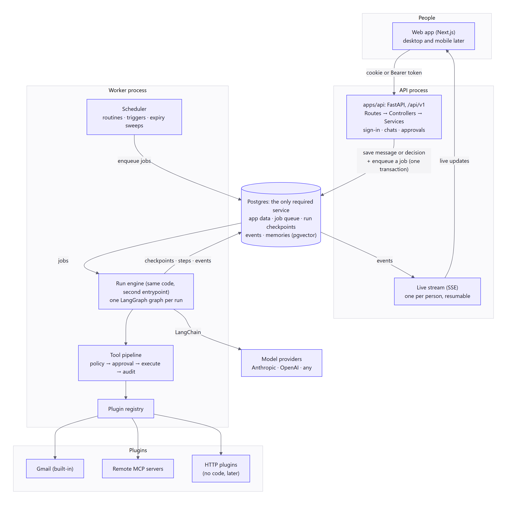

# Architecture: reading guide

Everything about how BotDesk works inside, in the order that makes it easiest to understand.

**Built today:** the web app (on mock data, partly wired to the API) and the API's sign-in, organizations, bots and chats. Bots don't reply yet. Runs, the queue, the worker, plugins and approvals below are the decided plan; [agents-and-plugins.md §14](agents-and-plugins.md#14-build-order-each-step-small-tested-and-usable) gives the build order. Terms are defined in [GLOSSARY.md](../../GLOSSARY.md).

## The idea in one minute



- **The web app** talks to **one API** (FastAPI, `/api/v1`).
- **A bot's work is a run.** A run is a LangGraph graph: think, use a tool, think again. A **worker** executes it, picking it up from a **job queue** that lives in Postgres.
- **Every action goes through one pipeline** that checks how risky it is:
  - safe things just happen
  - risky things **pause the run** until a person approves, edits or denies them
  - forbidden things are refused
- **A paused run costs nothing.** It's saved in Postgres and can wait for days, even across restarts.
- **Integrations are plugins.** A plugin describes its tools and how risky each one is, so adding the 200th integration never changes the core.
- **Postgres is the only required service.** It holds data, the queue, run checkpoints, live-update events and memory (pgvector).

## Read in this order

| # | Document | Time | What you'll understand |
|---|---|---|---|
| 1 | [agents-and-plugins.md](agents-and-plugins.md) | 30 min | The whole design, with diagrams: runs, the tool pipeline, approvals, triggers, memory, plugins and how it scales |
| 2 | [ADR 0004](../adr/0004-agent-runtime-and-safety.md) | 5 min | The safety rules that are now fixed: security levels, taint, approvals, nothing runs twice |
| 3 | [ADR 0005](../adr/0005-job-queue-and-scaling.md) | 5 min | The job queue, the worker, live updates, and the three scaling stages |
| 4 | [repo-structure.md](repo-structure.md) + [ADR 0006](../adr/0006-repo-structure-plugins-and-project.md) | 15 min | Where code goes as the project grows, the plugin SDK, and how contributions and releases work |
| 5 | [review-2026-11-12.md](review-2026-11-12.md) | 20 min | *Why* the design looks like this: what the review found, with sources |
| 6 | [high-level.md](high-level.md) | optional | The first proposal (TypeScript era), kept as history. Its stack was replaced by ADR 0003 and its runtime, security and plugin sections by ADRs 0004–0006. Still useful for the DeepSeek Harness study (§5.1), bot computers (§6) and the Gmail tool list (§8.7) |

## Diagrams

Every diagram is a Mermaid file in [diagrams/](diagrams/) with a PNG next to it in `diagrams/png/`. GitHub renders the Mermaid too. To change one, edit the `.mmd` file and run:

```bash
node docs/architecture/diagrams/render.mjs
```

## Where decisions live

Settled decisions are **ADRs** in [docs/adr/](../adr/): short, numbered, and never edited once accepted. To change one, write a new ADR that replaces it. The design documents explain *how*; the ADRs record *what we decided and why*.
