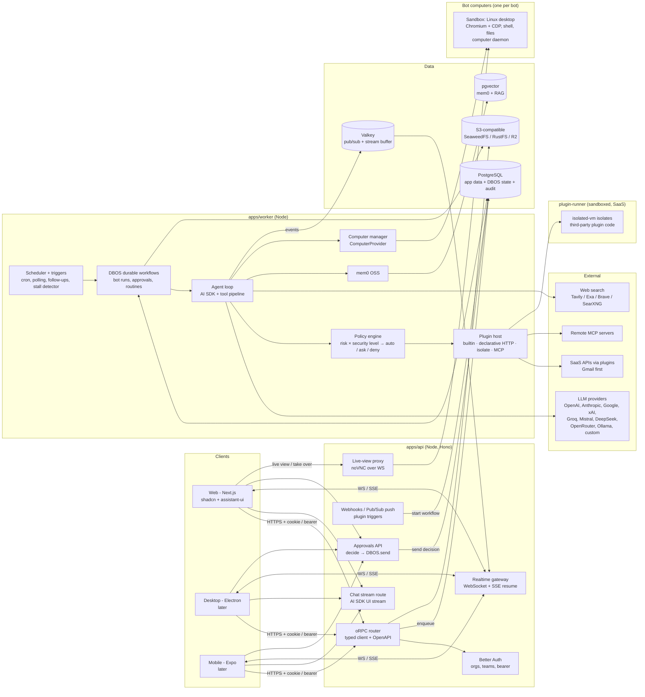

# BotDesk — High-Level Architecture (proposal)

> Status: **proposal for discussion**, 2026-11-11 (second pass). Nothing is built yet. Library versions and licenses were checked on npm/GitHub on 2026-11-11.
> Product: an open-source (MIT) **Grok Bot**, a team of always-on AI agents ("bots") with their own cloud computers, approvals, group chats, routines and memory. See [vision](../product/vision.md), [ADR 0001](../adr/0001-product-scope-and-deployment.md) and [ADR 0002](../adr/0002-grok-bot-parity-and-plugin-platform.md).

## Contents

0. Decided · 1. Grok Bot in one table · 2. System diagram · 3. Repo layout · 4. Backend & client API · 5. Agent runtime (incl. **DeepSeek Harness deep-dive**) · 6. Bot computers · 7. Streaming & realtime · 8. **Integration plugin platform** (+ Gmail example) · 9. **Security levels** · 10. **Approval system v1** · 11. Data model · 12. Tools, memory, files · 13. Self-hosting & deploy · 14. Security & multi-tenancy · 15. Cool ideas · 16. Owner questions · 17. Versions · Sources

## 0. Decided (owner, ADR 0001 + 0002) — not up for debate here

| # | Decision | What it forces in the architecture |
|---|---|---|
| D0 | Product = open-source Grok Bot (not the grok.com chat app) | Durable background agent runtime + sandboxed computers are the core; chat is the interface |
| D1 | Self-hosted **and** hosted SaaS | Multi-tenant from day one; every tenant table carries `org_id`; self-host = same code via docker-compose |
| D2 | Teams are core: orgs, members, roles, shared threads/projects, bots that belong to a team | Better Auth organization plugin; bots are org-scoped resources with RBAC |
| D3 | @mention people and bots in a chat | Threads have many participants (users + bots); mentions fan out to notifications or bot runs |
| D4 | Model keys: user BYOK **and** org keys; usage per user and per org | Credential resolution order + usage ledger keyed by org/user/bot |
| D5 | Grok's feel, BotDesk's own logo/accent | UI concern only |
| D6 | Web first (Next.js), then Electron, then Expo, all on one API | Separate API service with a typed client + OpenAPI; token auth for native clients |
| D7 | Node.js + PostgreSQL + Drizzle Kit migrations, MIT | Postgres-centric stack; prefer Postgres-native infra (queues, workflows, vectors) |
| D8 | **v1 = full Grok Bot parity**, UI follows Grok Bot's layout/flows | Computers, routines, group chats, approvals, proactive triggers all in v1 scope |
| D9 | **First integration: Gmail only** | Gmail is the worked example of the plugin platform (§8.7) |
| D10 | **Integrations are plugins** with a manifest (auth, tools, per-tool risk, triggers, settings); remote MCP = one plugin kind | Core never imports Gmail; plugin host + manifest schema are core (§8) |
| D11 | **Security levels**: per-tool risk + org/bot level decide auto vs approval | Policy engine reads manifests only (§9) |
| D12 | **Approvals: basic first**, extensible to rules/limits/multi-approver later | `approval_requests` + `approval_decisions` + decision trace (§10) |
| D13 | Learn from **DeepSeek Harness**; adopt or copy, decided in a later ADR | Deep-dive and recommendation in §5.1 |

## 1. Grok Bot in one table (what we are cloning)

| Grok Bot capability | Facts found | BotDesk building block |
|---|---|---|
| Bots = teammates you message | Up to 50 bots + group chats per account; 2–6 bots per group chat | `bots`, `threads`, `thread_participants` |
| Own cloud computer | One persistent Linux VM **shared by all of a user's bots** (files, browser sessions, CLI creds); bots are "separate work surfaces, not separate security boundaries" | `ComputerProvider` (Docker/E2B), **per-bot isolation by default** (differentiator) |
| Works in tools without API/MCP | Browser + desktop computer use | Computer-use loop + Stagehand/Playwright inside the sandbox |
| Signs into your tools | Bot never sees your password: user "takes over" the live computer view to log in / 2FA / CAPTCHA, session persists | Live view (noVNC) with take-over; persisted browser profile per bot; OAuth plugins for API tools |
| Runs while you're away | Jobs survive app close; one computer-use task per bot screen at a time | Durable workflows (DBOS) + per-bot queue partition with concurrency 1 |
| Approvals | Bot returns only for approval/judgment; model-based "Auto Review"; approvals don't undo completed work; no dry-run | Security levels + approvals inbox + durable wait; we add dry-run and audit |
| Bot-to-bot + group chats | Async bot-to-bot messages that wake the receiver; "chief of staff" pattern (no special manager type) | Mentions → enqueue run for target bot; hop/budget guards |
| Routines ("follow along") | Records browser-only, max 10 min, no audio; output is a draft you refine; 50 routines/bot, 20 run records kept; can be scheduled | `routines` + `routine_versions` (versioned, diffable, exportable — Grok lacks this) |
| Memory + proactive | Remembers conversations, preferences; follows up on dropped threads, nudges stalled handoffs | mem0 OSS + triggers/scheduler + "stall detector" job |
| Clients | macOS + iOS, same thread across devices | Web → Electron → Expo, realtime event stream with resume |
| Usage | Own usage pool, metered weekly, token-billed overage | `usage_events` ledger + budgets |
| Marketplace / Guides | "Team skills marketplace" on Cursor Premium Teams; contents not public (x.ai marketplace page returned 403) | Plugin registry (§8.5) + `bot_templates` |

## 2. System diagram



## 3. Repo layout

**Recommendation: pnpm + Turborepo monorepo** (matches the scaffold already created). *Why:* lightest setup that gives cached builds and shared TS packages across web/desktop/mobile. *Alternative:* Nx (stronger generators/graph, heavier, more opinionated).

| Path | What | Notes |
|---|---|---|
| `apps/web` | Next.js App Router + Tailwind v4 + shadcn/ui + assistant-ui | **Exists.** UI only — no business logic in route handlers except BFF auth glue |
| `apps/api` | Hono HTTP server: oRPC router, chat stream route, realtime gateway, webhooks, approvals, live-view proxy, Better Auth | Stateless, horizontally scalable |
| `apps/worker` | DBOS workflows: bot runs, approvals, routines, triggers, memory writes, file ingestion, computer lifecycle | Same codebase as API, separate process |
| `apps/plugin-runner` | Hosts third-party plugin code in V8 isolates; no DB access, egress-allowlisted | SaaS-only at first (§8.4) |
| `apps/desktop` | Electron shell (later) | Loads web UI; tray, notifications, deep-link auth, optional "local computer" |
| `apps/mobile` | Expo + NativeWind + react-native-reusables + `@assistant-ui/react-native` (later) | Uses `packages/sdk` |
| `packages/db` | Drizzle schema, migrations, tenant-scoped repositories | Single source of truth for tables |
| `packages/contract` | oRPC contract (zod schemas for every procedure + event types) | Imported by api, sdk, clients |
| `packages/sdk` | Typed client built from the contract + realtime client (WS/SSE with resume) | What web/desktop/mobile call |
| `packages/core` | Domain logic: permissions, key resolution, mention parsing, usage pricing | Pure TS, heavily unit-tested |
| `packages/policy` | Risk taxonomy, security levels, policy evaluation, decision traces, taint rules | Pure TS; the only place auto/ask/deny is decided |
| `packages/agent` | Agent loop, tool pipeline (pre/execute/post hooks), model registry, memory adapter | Runs in worker |
| `packages/plugin-sdk` | `definePlugin()`, manifest JSON Schema, types, test harness, preview kinds | **Public, MIT** — what plugin authors import |
| `packages/plugin-host` | Registry, loader, runtime tiers (builtin / declarative HTTP / isolate / MCP), credential binding, trigger runner | Core; knows no specific integration |
| `packages/computer` | `ComputerProvider` interface + adapters (`docker`, `e2b`, later `local`) + computer-use/Stagehand tools | |
| `plugins/gmail` | First-party Gmail plugin (built with `plugin-sdk` only) | Proves the core needs no Gmail code |
| `plugins/*` | Future first-party plugins (calendar, slack, github, …) | Each is self-contained |
| `packages/ui` | Shared shadcn components/tokens for web + desktop | Mobile uses RN equivalents |
| `packages/config` | tsconfig, eslint, tailwind preset | |
| `infra/computer-image` | Dockerfile for the bot desktop (Xvfb + XFCE + Chromium + VNC + computer daemon) | Not a JS package |
| `infra/compose` | docker-compose for self-host | |

## 4. Backend shape & client API

| Question | Recommendation | Why (1 line) | Alternative |
|---|---|---|---|
| Where the backend lives | **Separate Node service `apps/api` + `apps/worker`**, not Next.js route handlers | Desktop/mobile/webhooks/bot runtime need a long-running, framework-independent server; Next stays a UI | Next.js route handlers (fine for chat-only, wrong for 24/7 agents) |
| HTTP framework | **Hono** (4.13, MIT) on `@hono/node-server` | Tiny, Web-standard Request/Response (same as AI SDK), runs on Node/Bun/edge | Fastify 5 (mature plugins, Node-only); NestJS (too much ceremony) |
| Typed client | **oRPC** (1.16, MIT) contract-first | One contract → typed client for web/Electron/Expo **and** an OpenAPI spec for third parties; built-in SSE event iterators | tRPC 11 (no first-class OpenAPI); Hono RPC (types only, no OpenAPI) |
| Chat streaming endpoint | Plain Hono route speaking the **AI SDK UI message stream** | `useChat`/assistant-ui transports expect it; works on Expo via `expo/fetch` | Wrap in oRPC event iterator |
| Auth | **Better Auth** 1.7 (MIT): organization plugin (teams + dynamic access control), `bearer()`, `@better-auth/expo`, `@better-auth/electron` | All three client types covered by first-party plugins (all at 1.7.20) | Auth.js; Keycloak/Zitadel (heavier) |
| ORM / migrations | **Drizzle ORM + Drizzle Kit** — pin stable `0.45.x`/`0.31.x` now, plan upgrade to 1.0 (RC) | SQL-first, light, versioned migrations | Prisma (great DX, heavier runtime, separate schema language) |

**How Electron and Expo call it:** same `packages/sdk` against `https://api.<host>`; web uses cookies (same-site or via Next rewrite), Electron uses deep-link login (`@better-auth/electron`) + bearer token in OS keychain, Expo uses `@better-auth/expo` + SecureStore. Realtime via the same WS endpoint. Approvals can be decided from any client (and later from push notifications).

## 5. Agent runtime & orchestration (the core)

### 5.1 DeepSeek Harness (dsh) deep-dive — adopt, copy, or hybrid?

**What it is (read from the repo, master @ 2026-11-11):** `deepseek-ai/deepseek-harness`, MIT, created 2026-08-13, ~279k stars. npm `@deepseek-ai/dsh` **0.2.2-rc.1** (repo at 0.2.2-rc.2, so not 0.1.x any more). Node ≥ 24.9. README: "developer preview… THERE WILL BE COMPATIBILITY-BREAKING CHANGES". SAFETY.md: "has not undergone a security audit and must not be treated as secure or production-ready".

| Area | How dsh does it | Notes for BotDesk |
|---|---|---|
| Kernel | **Cordis** (vendored as `@deepseek-ai/cordis` 4.0.0-rc.11): plugins provide **services** on `ctx.<key>`, declare dependencies via `inject`, talk via typed events (`emit`/`waterfall`/`parallel`/`serial`/`bail`); **every registration is a reversible effect** that is undone when the plugin unloads | The idea we want to copy most: install/uninstall cleans up after itself |
| "Everything is a plugin" | The model adapter (`ctx.llm`), tool registry (`ctx.tools`), session log (`ctx.sessions`), agent registry, and even the **agent loop** (`ctx.agentLoop`) are swappable plugins | Same design rule for us: core = seams, features = plugins |
| Capability seams | Each capability has three roles: Service Definition / Provider / Consumer. Example: fs + subprocess providers point at a remote sandbox, and bash/PTY/LSP move with them | Matches our `ComputerProvider`, `ModelProvider` and plugin runtime tiers |
| Model adapter | `ctx.llm` + adapters: DeepSeek API key/account, and `llm-pi-ai` for other providers; `llm-retry` at durable step boundaries | We use AI SDK providers instead (broader, already decided) |
| Tool registry | `ToolDefinition` = model schema + **mandatory output JSON Schema** + `execute(args, {signal})` + `timeoutMs` + `isConcurrencySafe` + UI presenters (`presentCall`/`presentResult`); pipeline = `tools/pre-execute` → `tools/execute` → `tools/post-execute` waterfalls | Copy: output schemas, presenters (= our approval previews), waterfall hooks for policy/approval/audit/taint |
| Session log | Append-only `SessionEvent` log; **"model-visible ⟺ logged"**: every model request can be rebuilt from the log; fork/resume/telemetry all come from it. Storage = **JSONL files per session on local disk** (zstd), one writer per backend instance, `list()` unpaginated, no deletion/retention API | Copy the rule; store in Postgres (`messages` + `run_steps`) instead of files |
| Agent loop | turn → steps (model request + tool calls); hooks `agent/pre-step`, `agent/request`, `agent/turn-stopping`; `inject()` for context; checkpoint policy makes model requests + tool side effects durable before the next action | Same idea as our DBOS steps |
| Subagents | `ctx.subagents` providers: in-process spawn/fork, ACP, **Codex, Claude Code**, another dsh over SDK; tools for delegate / message / interrupt / list; **Agent Teams** add a shared task board | Our bot-to-bot + `tasks` table; external-agent providers are a good later plugin type |
| Plan mode | `/plan` → agent explores, then `exit_plan_mode` presents a plan **for approval**; guides but doesn't restrict tools | Copy as an approval kind: "approve plan" before long jobs |
| Approvals / permissions | `ctx.approval`: one-shot allow/reject from composed **answerers** (waterfall); policy `ask` / `never`; **fails closed** with no answerer; audit events `approval/asked` + `approval/decided`. `permission-presets` bundle sandbox mode + approval policy (e.g. `workspace-write`, `danger-full-access`, plus "Auto review") | Copy: fail-closed, answerer chain (human UI, Auto Review model, policy rules), presets = our security levels |
| Presets / profiles | **Profiles** = ordered **bundles** of `cordis.yml` rows + user patches (`web`, `headless`, `sdk`, `acp`); **agent presets/personas** compose a per-session capability set | Bot templates = presets; org/bot overrides = patches |
| Plugin packaging | npm packages `@deepseek-ai/dsh-*`; bundles declare `dsh.bundle` in `package.json`; `plugin-manager` installs via **pnpm** (npm registry or Git commits) into the **profile**, changes "affect every session using the profile"; `plugin-market` reads **user-configured JSON index URLs** (unsigned) for a Discover tab; GitHub topic `dsh-plugin` | Copy the index format idea; don't copy pnpm-install-at-runtime (wrong for multi-tenant SaaS) |
| Credentials | `ctx.credentials`: env-var-shaped references + per-plugin records in a **local private YAML file**; `authorization` flows ask a human, not resumable, no revoke | Too local for us; we need encrypted per-org/per-user/per-bot connections |
| Embedding / server | Apps launch only via `dsh --profile …`; TS SDK **spawns a dsh subprocess over stdio JSON-RPC**; no per-prompt cancel; SDK sessions stay live until shutdown. Remote BFF has owner + limited "non-owner Peer" access | Single-user, one process per user/home |

**Verdict: it is a single-user local harness (desktop app / web UI / CLI / SDK subprocess), not a multi-tenant library.** Running hundreds of org-scoped bots in one Node server would mean one dsh process + home dir per bot, file-based sessions and credentials, runtime pnpm installs, and no cancel — and it's an unaudited preview with planned breaking changes.

| Option | Verdict |
|---|---|
| (a) Adopt dsh/Cordis as BotDesk's runtime | **No.** Multi-tenancy, Postgres state, encrypted credentials, durable cross-process runs and cancel would all have to be rebuilt *inside* a fast-moving preview we don't control |
| (b) Copy its plugin model on DBOS + AI SDK | **Yes — this is the core of the recommendation.** Copy: capability seams; reversible registrations; tool pipeline waterfalls; mandatory output schemas + presenters; "model-visible ⟺ logged"; fail-closed approval answerers; permission presets → security levels; plan-approval; presets → bot templates; index-based plugin market |
| (c) Hybrid | **Later, optional:** add a `subagent` provider that runs `dsh --profile sdk` (or Claude Code/Codex) **inside a bot's own computer**, where single-user is exactly right — e.g. a "coding" bot. Revisit when dsh is ≥ 1.0 |

**Recommendation: (b) now, (c) as an opt-in plugin later.** Record this in ADR 0003.

### 5.2 Durable workflows

| Option | License | Infra needed | Verdict |
|---|---|---|---|
| **DBOS Transact (TS)** | MIT | **Only Postgres** (library, no extra server) | **Recommended.** Durable steps, `send`/`recv` (approvals, bot-to-bot wake-ups), durable sleep, cron, queues with per-partition concurrency, rate limits, dedup, priority |
| Vercel Workflow SDK + `@workflow/world-postgres` | Apache-2.0 | Postgres + graphile-worker | Watch: native fit with AI SDK 7 `WorkflowAgent`, but Postgres World is a "reference implementation, not optimized for scale, speed, or security" |
| Temporal | MIT | Separate Temporal cluster | Gold standard; too heavy for self-host compose |
| Trigger.dev | Apache-2.0 | Own platform stack | Heavy to self-host alongside ours |
| Inngest | SSPL (→ Apache later) | Inngest server | **Avoid** (SSPL) |
| pg-boss / BullMQ | MIT | Postgres / Redis | Job queues only; DBOS queues cover this |

**Run model**
- Every bot task = one **`bot_run` workflow** on queue `bot-runs`, partition key = `bot_id`, `partitionConcurrency: 1` (one job at a time per bot computer, like Grok), global concurrency per org plan.
- Each LLM turn and each tool call is a DBOS **step** (checkpointed → survives deploys/crashes). Side-effecting tools carry idempotency keys (`run_id:step`), so a retry never sends an email twice.
- **Tool pipeline (dsh-style hooks):** `pre-execute` (validate args → policy → approval wait → taint check) → `execute` (plugin host) → `post-execute` (validate output schema, mark untrusted, audit, usage). Policy and approvals live in this pipeline, never inside plugins.
- Agent loop = AI SDK 7 (`ai` 7.0, Apache-2.0) `streamText`/agent with tools, run inside steps; stream chunks published to Valkey for live UI.
- **Stop/cancel** = `DBOS.cancelWorkflow` + `AbortSignal` into the current step; partial message saved; pending approvals → `cancelled`.

### 5.3 Bot-to-bot, group chats, @mentions

- A thread has participants (users and bots). A message mentioning `@bot` → `enqueue bot_run(bot, thread, trigger_message)`. Mentioning `@user` → notification.
- Bots mention other bots the same way (tool `send_message(thread, text, mentions)` / `delegate(bot, task)`), which wakes the receiver — the "chief of staff" pattern needs no special type.
- **Loop guards:** max hop depth per causal chain, per-thread bot-message rate limit, per-run token/cost budget, "ask a human" fallback.
- **Ownership:** `tasks` table lets bots assign/claim work items visible in the thread (feeds "nudge stalled handoffs").
- A delegated bot runs at **its own** security level, never the caller's; delegation can't be used to escalate.

### 5.4 Proactive scheduler & triggers

- Trigger sources: **plugin triggers** (§8: webhook, push, poll), `cron`, `inbound_email`, `follow_up` (bot-created timer), `thread_stall`.
- DBOS scheduled workflows run cron and plugin polling; follow-ups = durable sleep; a **stall detector** (hourly) finds open `tasks` / unanswered threads and wakes the owning bot with a "nudge" prompt.

## 6. Bot computers (sandboxes)

**Recommendation: a `ComputerProvider` interface with two adapters from day one.**

| Adapter | Use | License / status | Notes |
|---|---|---|---|
| **`docker`** (default self-host) | One container per bot from `infra/computer-image` | Our image (MIT) bundling Chromium, XFCE, VNC | Run with **gVisor (`runsc`)**; named volume per bot (home + browser profile); controlled by a separate `computer-manager` behind a docker-socket proxy, never the API |
| **`e2b`** (default SaaS) | Firecracker microVM per bot | SDK Apache-2.0; infra self-hostable (`e2b-dev/runtime`, Apache-2.0) | Pause/resume keeps FS + memory; paused sandboxes kept indefinitely; 24h continuous run on Pro (pause resets) |
| `local` (later, Electron) | Bot drives the user's own machine/VM | Cua drivers (MIT) | Opt-in "bring your own computer" |
| ~~Daytona~~ | — | OSS repo **unmaintained since June 2026** | Avoid |
| KasmVNC / noVNC | VNC server / web client | GPL-2.0 (separate binary) / MPL-2.0 | Inside the image only |

**Inside the computer:** a small **computer daemon** (private network) exposing `screenshot`, `click/type/key/scroll`, `shell`, `files`, and a Chromium **CDP** endpoint.

**How bots act:** APIs first (plugins/MCP) → web pages via **Stagehand** (MIT) on Playwright (Apache-2.0) over CDP → anything else via provider **computer-use** tools over screenshots. Computer actions are tools too, so they go through the same policy: e.g. `computer.browser_submit_form` = `write-external`, typing into a login form = `credential`.

**Login:** like Grok, bots never get raw passwords by default. Bot hits a login → raises a `takeover` approval → user opens **live view** (noVNC proxied through `apps/api`, auth-checked, time-boxed) and logs in → profile persists on the bot's volume. Default **one computer per bot** (Grok shares one per user).

## 7. Streaming & realtime

| Concern | Recommendation | Alternative |
|---|---|---|
| Transport | **WebSocket** gateway in `apps/api` for multi-user threads (messages, typing, presence, approvals, bot status) + **SSE** for single-response streams and resume | Centrifugo (Apache-2.0); Postgres LISTEN/NOTIFY for tiny self-hosts |
| Fan-out | **Valkey** (BSD-3) pub/sub + Streams | Redis 8 (AGPL/RSAL/SSPL tri-license — prefer Valkey) |
| Resume mid-generation | Worker appends every chunk to a per-run Valkey Stream (`XADD`, TTL); clients reconnect with last event id and replay; final parts persisted to Postgres | `resumable-stream` (ISC) + `activeStreamId` for the plain 1:1 chat route |
| Multi-device / multi-user | Generation runs in the worker, so any number of devices/participants subscribe to the same run | — |
| Stop | Explicit `POST /runs/:id/cancel` (client disconnect ≠ stop, matching AI SDK guidance) | — |
| Presence/typing | Ephemeral, Valkey only | — |

## 8. Integration plugin platform

Goal (D10): Gmail first, then #2…#200 **without touching the core**. The core only knows the plugin interface; risk levels come from manifests, so policy needs no per-integration code.

### 8.1 Plugin kinds (runtime tiers)

| Tier | `runtime` | Who writes it | Where code runs | Isolation |
|---|---|---|---|---|
| T0 | `builtin` | BotDesk team (Gmail, Calendar, Slack…) | In `apps/worker` | Code review + same tests as core; still uses only `plugin-sdk` APIs |
| T1 | `http` (declarative) | Anyone | **No plugin code**: manifest maps each tool to an HTTP request template + response mapping; core executes it | Safest path for third parties; covers most simple REST APIs |
| T2 | `isolate` | Third parties | `apps/plugin-runner`: one **V8 isolate per call** (`isolated-vm` 7.x, ISC) with CPU/memory/time limits and no Node APIs; only `ctx` bridges | Isolates are not a hard boundary against V8 bugs → runner process in a gVisor container, no DB/secret-store access, egress allowlist from manifest |
| T3 | `mcp-remote` | Anyone running an MCP server | Their server (Streamable HTTP) | Network boundary; MCP OAuth for auth; tool list snapshotted and reviewed (§8.6) |
| T4 (later) | `computer` | Anyone | Inside the bot's computer (e.g. a CLI, a local MCP over stdio, or dsh/Claude Code as a sub-agent) | The bot's sandbox |

### 8.2 Manifest (shape)

Plugins are authored with `definePlugin()` from `@botdesk/plugin-sdk`; the **manifest is plain JSON** (stored in the registry, diffed between versions, shown on consent screens), and code handlers are bound by name.

```ts
definePlugin({
  manifest: {
    manifestVersion: 1,
    id: "botdesk.gmail",              // reverse-DNS, globally unique
    version: "1.0.0",                 // semver
    name: "Gmail", description: "...", icon: "./icon.svg",
    publisher: { name: "BotDesk", verified: true },
    engine: { botdesk: "^1.0.0" },
    runtime: "builtin",               // builtin | http | isolate | mcp-remote
    auth: [{
      type: "oauth2",                 // oauth2 | api_key | basic | browser_login | none
      provider: "google",
      authorizationUrl: "https://accounts.google.com/o/oauth2/v2/auth",
      tokenUrl: "https://oauth2.googleapis.com/token",
      pkce: true,
      scopes: { base: ["openid", "email"], byTool: true },  // incremental auth per enabled tool
      owner: ["user", "bot", "org"],  // who may own the connection
      byoClient: true                 // org can supply its own OAuth client (self-host)
    }],
    permissions: { egress: ["gmail.googleapis.com", "oauth2.googleapis.com"], kvQuotaKb: 64 },
    settings:    { /* JSON Schema: org-level settings */ },
    botSettings: { /* JSON Schema: per-bot settings */ },
    tools: [{
      name: "send",                   // exposed to the model as gmail_send
      title: "Send email",
      description: "...",
      input:  { /* JSON Schema */ },
      output: { /* JSON Schema (mandatory, like dsh) */ },
      risk: "send",                   // read | write-internal | write-external | send | spend | delete | credential
      approval: "policy",             // policy | always  (a plugin can only make things stricter)
      riskEscalation: [{ when: "recipientsOutsideThread", risk: "send", approval: "always" }],
      scopes: ["https://www.googleapis.com/auth/gmail.send"],
      untrustedOutput: false,         // true = output is third-party content (prompt-injection taint)
      idempotent: false,
      preview: "email",               // email | message | diff | payment | file | json
      rateLimit: { perMinute: 20 }
    }],
    triggers: [{
      name: "new_email",
      kind: "push",                   // webhook | push | poll
      fallback: { kind: "poll", intervalSec: 60 },
      payload: { /* JSON Schema */ },
      dedupeKey: "messageId",
      untrustedPayload: true
    }]
  },
  tools:    { send: async (args, ctx) => { /* ctx.http, ctx.kv, ctx.log, ctx.signal */ } },
  previews: { send: (args) => ({ kind: "email", to: args.to, subject: args.subject, body: args.body }) },
  triggers: { new_email: { setup, teardown, onPush, poll } }
})
```

**Plugin `ctx` (the only things a plugin can touch):** `ctx.http` (fetch that injects the bound credential and enforces `egress`), `ctx.kv` (plugin+connection-scoped state, e.g. a Gmail `historyId` cursor), `ctx.files` (scoped S3 put/get), `ctx.log`, `ctx.signal`, `ctx.settings`. No DB, no other plugins' secrets, no raw tokens (T2+ never see the token; `ctx.http` adds it in the host).

### 8.3 Lifecycle

| Step | Who | What happens | Tables |
|---|---|---|---|
| Publish | Plugin author / BotDesk | Version uploaded (or bundled), manifest validated, integrity hash stored; public versions signed | `plugins`, `plugin_versions` |
| Install (per org) | Org admin | Picks a version; consent screen shows **scopes, egress, tools and risk levels**; version pinned | `plugin_installations` |
| Configure | Org admin | Org settings (e.g. bring-your-own OAuth client, Pub/Sub topic) | `plugin_installations.settings` |
| Connect (credential binding) | User / admin | OAuth or API key → encrypted **connection**, owned by a user, a bot (least privilege) or the org | `connections` |
| Enable per bot | Bot owner | Choose tools, the connection, per-tool overrides (stricter only), bot settings; triggers subscribed | `bot_plugin_bindings`, `trigger_subscriptions` |
| Run | Runtime | Per-run toolset = bindings × installation version; **version pinned for the whole run** (deterministic replay) | `runs.plugin_versions` |
| Upgrade | Admin / auto | Patch/minor auto-applies **only if** no new scopes, egress, tools or higher risk; otherwise it waits for re-consent | `plugin_installations` |
| Disable / uninstall | Admin | Stop triggers, revoke tokens at the provider (if supported), delete secrets, keep audit | — |

### 8.4 Isolation rules

- Policy, approvals, audit, taint and usage run in the **host pipeline**, outside plugin code; a plugin can't skip approval.
- Secrets never enter plugin memory for T1–T3; T0 gets them via `ctx.http` too (same code path).
- Egress is enforced in `ctx.http` (T0/T1) and at the network layer for the runner (T2).
- Hard limits per call: timeout, response size, memory (T2), rate limit per connection.
- **SaaS:** only T0, T1, and *verified* T2/T3 publishers in the public registry; orgs may add private T1/T3 plugins. **Self-host:** admin may allow anything.

### 8.5 Registry & marketplace

- **Sources:** bundled (T0 in the repo) · org-private (uploaded manifest/bundle) · public **index** (dsh-style JSON index files listing plugin ids, versions, download URL, `sha256`, signature; we **sign** indexes — dsh's are unsigned).
- Marketplace UI = search over configured indexes + install status + compatibility (`engine.botdesk`) + consent diff — the dsh "Discover" pattern.
- **Bot templates** (marketplace items for whole bots) reference plugins by `id@range` and bring instructions, routines and a suggested security level.

### 8.6 Remote MCP = one more plugin kind

- An org admin adds an MCP server URL → a `mcp-remote` installation with `auth: oauth2` (MCP authorization spec) or API key.
- On connect, tools are **discovered and snapshotted** into the installation as generated tool entries (input schema from MCP).
- Risk is derived from MCP tool annotations: `readOnlyHint` → `read`; `destructiveHint` → `delete`; otherwise → `write-external`; `openWorldHint` → `untrustedOutput: true`. The admin can change risk per tool; **unannotated tools default to `write-external` (ask)**.
- **No silent tool changes:** if the server's tool list or schemas change, the new tools stay disabled until an admin reviews the diff (prevents tool definitions being swapped after approval).

### 8.7 Worked example: Gmail plugin (`plugins/gmail`, T0)

**Auth:** OAuth2 (Google), owner = user or bot-dedicated mailbox; incremental scopes; `byoClient` so self-hosters use their own Google Cloud OAuth client.

| Tool | Gmail API | Scope (minimum) | Risk | Untrusted output | Preview | Default at L2 "Ask before acting" | Default at L3 "Trusted" |
|---|---|---|---|---|---|---|---|
| `gmail_search` | `users.messages.list` (q=) | `gmail.readonly` | read | yes (snippets) | — | auto | auto |
| `gmail_read` (message/thread) | `users.messages.get`, `users.threads.get` | `gmail.readonly` | read | **yes** | — | auto | auto |
| `gmail_draft` | `users.drafts.create/update` | `gmail.compose` | write-external | no | email | **ask** | auto |
| `gmail_label` (add/remove) | `users.messages.modify` | `gmail.modify` | write-external | no | diff (labels) | **ask** | auto |
| `gmail_archive` | `users.messages.modify` (remove `INBOX`) | `gmail.modify` | write-external | no | diff | **ask** | auto |
| `gmail_send` (new / reply / send draft) | `users.messages.send`, `users.drafts.send` | `gmail.send` | **send** | no | email | **ask** | **ask** |
| *(not in v1)* `gmail_trash`, `gmail_forward`, filters, delegation | — | — | delete / send / credential | — | — | — | — |

`gmail_send` extra rules: always **ask** if any recipient is not already on the thread or in the org domain, or if the run is **tainted** by untrusted email content (§9.4) — at every level except L4 with an explicit org opt-out.

**Trigger `new_email`:** SaaS = **push** via `users.watch` → Google Cloud Pub/Sub → `apps/api` webhook (watch must be renewed, at most every 7 days → daily DBOS cron); self-host = **poll** `users.history.list` every 60 s with the `historyId` cursor in `ctx.kv`. Filter by label/query in bot settings; dedupe on `messageId`; payload (from, subject, snippet) is **untrusted**.

**Settings:** org — OAuth client (optional BYO), Pub/Sub topic (push mode); bot — label filter, signature, default "send as", which tools are enabled.

**Caveat (SaaS):** `gmail.readonly`/`gmail.modify`/`gmail.compose` are Google **restricted scopes** → a published SaaS app needs Google OAuth verification plus a yearly third-party security assessment (CASA). Self-hosters with their own OAuth client in testing/internal mode avoid this. Plan the time and cost before SaaS launch.

## 9. Security levels

### 9.1 Risk taxonomy (per tool action, declared in the manifest)

| Risk | Meaning | Examples | Reversible? |
|---|---|---|---|
| `read` | Reads data, changes nothing | search mail, read file, web search | — |
| `write-internal` | Changes only BotDesk-owned state or the bot's own sandbox | write memory, create task, edit file in bot computer, run code in sandbox | yes |
| `write-external` | Changes data in a third-party system, reversible, no one else is notified | draft, label, archive, create calendar hold, submit form on a site | mostly |
| `send` | Communicates to other people as the user/org | send email, post to Slack, comment on GitHub, invite to meeting | **no** |
| `spend` | Commits money or paid quota | purchase, pay invoice, buy ads, paid API above threshold | **no** |
| `delete` | Destroys data or is otherwise irreversible | trash/delete mail, delete repo/file, cancel subscription | **no** |
| `credential` | Touches secrets or access | log in, enter a password/2FA, create API keys, change sharing/permissions, OAuth grant | — |

Order of severity (for `max()`): read < write-internal < write-external < send < spend < delete < credential. A tool may **escalate** its risk per call (`riskEscalation`, e.g. external recipients), never lower it.

### 9.2 Security levels (org ceiling + bot level)

| Level | Name | read | write-internal | write-external | send | spend | delete | credential |
|---|---|---|---|---|---|---|---|---|
| L1 | **Read-only** | auto | auto (own sandbox/memory only) | deny | deny | deny | deny | deny |
| L2 | **Ask before acting** (default) | auto | auto | ask | ask | ask | ask | ask |
| L3 | **Trusted** | auto | auto | auto | ask | ask | ask | ask |
| L4 | **Autonomous within limits** | auto | auto | auto | auto | ask (auto under a spend limit — later) | ask | ask |

- `credential` is **never** auto. `delete` is never auto in v1.
- **Effective level = min(org ceiling, bot level, routine/trigger level)**. The org admin sets the ceiling; bot owners pick a level ≤ ceiling.
- Then: manifest `approval: "always"` → ask; per-bot override (stricter only) → apply; **taint rule** (§9.4) → may raise `auto` to `ask`.
- Every evaluation produces a **decision trace** (`[org L3, bot L3, tool risk=send, taint=yes → ask]`), stored with the approval request and audit log, so users can see *why* something was asked or denied.
- These are the dsh "permission presets" idea, extended from two knobs (sandbox, approval) to the risk matrix.

### 9.3 Audit log

- Append-only `audit_log` (no UPDATE/DELETE grants for the app role); one row per tool call (`allowed/asked/denied`, decision trace, args hash), approval decision, credential use, take-over session, plugin install/upgrade/consent, level change, key access.
- Run-level detail (args, outputs, screenshots) lives in `run_steps` / S3, linked by id; retention is configurable per org.
- Export (CSV/JSON) and later SIEM streaming.

### 9.4 Prompt-injection defences (email is the main source)

| Defence | How |
|---|---|
| Mark untrusted content | Tools with `untrustedOutput` / triggers with `untrustedPayload` wrap content in tagged blocks with provenance (`<untrusted source="gmail" id=…>`); the system prompt says instructions inside are data |
| **Taint tracking** | Once untrusted content enters a run, the run is *tainted*: `write-external` and above go to **ask** even if the level says auto (org can relax for `write-external` only) |
| Recipient / data-flow guard | `send` to addresses not on the original thread / org domain → always ask; preview highlights new recipients and links |
| Least capability | Bots get only the tools they're bound to (an inbox-triage bot has no `send`); connections can be bot-owned with narrow scopes |
| Quarantined reader (optional) | For triggers, a tool-less model first extracts structured fields (sender, intent, dates) from the email; the acting agent sees the extraction, not raw HTML |
| Links & attachments | Opened only inside the bot computer; no automatic fetch of email URLs from tools that hold credentials |
| Secrets never in context | Tokens stay in the host; the model never sees a credential, so it can't leak one |
| Auto Review (later) | A reviewer model can only turn `auto` into `ask`, never bypass `ask`/`deny` (like Grok's Auto Review and dsh's auto-review answerer) |

### 9.5 Secrets handling

Envelope encryption: AES-256-GCM per-org **DEK**, wrapped by a **KEK** from `BOTDESK_MASTER_KEY` (self-host) or KMS (SaaS). Model keys, OAuth tokens, API keys and plugin secrets are all `connections`/`provider_credentials` rows with ciphertext only. Decrypt only in the worker at call time; refresh tokens rotated by the host; never returned to clients (last 4 only); every decrypt is audited. Key rotation re-wraps DEKs without re-encrypting data.

## 10. Approval system v1 (basic, extensible)

### 10.1 Data model

| Table | Key columns | Notes |
|---|---|---|
| `approval_requests` | id, org_id, run_id, workflow_id, step_key (unique with workflow_id → idempotent), bot_id, thread_id, kind (`tool_call` / `plan` / `takeover`), plugin_id, plugin_version, tool_name, risk, **proposed_args** (jsonb), **args_hash**, **preview** (jsonb: typed kind = email/message/diff/payment/file/json), taint (sources), **decision_trace** (jsonb), required_approvals (v1 = 1), eligible_approvers (jsonb: v1 = thread owner + bot owner + org admins), status (`pending/approved/denied/expired/cancelled`), final_args, final_args_hash, created_at, expires_at, resolved_at | One row per pause |
| `approval_decisions` | id, request_id, approver_user_id, decision (`approve/deny/edit_approve`), edited_args, note, via (web/desktop/mobile/email/slack), created_at, signature | v1: the first valid decision resolves the request. Multi-approver later = count rows, no schema change |
| `approval_policies` *(later)* | id, org_id, scope (org/team/bot/plugin/tool), match (jsonb), effect (auto/ask/deny), required_approvals, approver_roles, spend_limit, expires_at | Evaluated by `packages/policy` *before* the level matrix; adds lines to `decision_trace` |

### 10.2 Flow

```mermaid
sequenceDiagram
  participant AG as Agent step (DBOS)
  participant POL as Policy
  participant DB as Postgres
  participant RT as Realtime/Push
  participant U as Approver (any client)
  participant API as apps/api

  AG->>POL: tool call (args)
  POL-->>AG: ask (decision_trace)
  AG->>DB: insert approval_request (idempotent on workflow_id+step_key) + preview
  AG->>RT: publish approval.created, notify eligible approvers
  AG->>AG: DBOS.recv("approval:"+id, timeout = expires_at)
  U->>API: approve / deny / edit+approve (note)
  API->>API: authz (eligible approver), validate edited args vs tool input schema
  API->>POL: re-evaluate edited args (risk may not exceed what is shown)
  API->>DB: insert approval_decision, set status + final_args_hash
  API->>AG: DBOS.send(workflow_id, decision, "approval:"+id)
  alt approved
    AG->>AG: verify final_args_hash, execute tool with final args, audit
  else denied / expired
    AG->>AG: return "denied by <user>: <note>" as tool result; model continues or asks
  end
```

**Rules**
- **Zero compute while waiting:** the workflow is parked in DBOS; runs survive deploys while waiting days.
- **Expiry:** default 72 h (org-configurable) → `expired` = treated as denied + notification.
- **Edit:** edited args are validated against the tool's input schema and re-run through policy; if an edit raises the risk (e.g. adds an external recipient), the request is re-issued instead of auto-resolving.
- **Integrity:** the tool runs only with `final_args` whose hash matches the decision; decisions are signed (AI SDK 7 HMAC-signed approvals or our own HMAC), so a forged API call can't resume a workflow.
- **Concurrency:** first decision wins (row lock on the request); later decisions get `409 already resolved`.
- **Cancel:** cancelling the run marks pending requests `cancelled`.
- **No undo:** an approval approves the action, it doesn't make it reversible — the preview must show exactly what will happen (Grok has the same limit; we're explicit about it).
- **Fail closed:** no eligible approver, a policy error or a missing preview → deny + notify the org admin (the dsh rule).

### 10.3 Why this extends without a rewrite

| Later feature | How it plugs in |
|---|---|
| Policy rules ("auto-approve labels on newsletters") | `approval_policies` evaluated in `packages/policy`; result + rule id appended to `decision_trace` |
| Spending limits | `spend` tools declare `amount` in their preview; a policy evaluator compares against `budgets` |
| Multi-approver / quorum | `required_approvals > 1`; resolve when the count of `approve` decisions reaches it |
| Delegated approvers, on-call | `eligible_approvers` computed by a policy instead of the v1 default |
| "Always allow this pattern" | A decision with `remember=true` creates an `approval_policies` row (admin-reviewed) |
| Auto Review model | An extra evaluator that can only add `ask`, never remove it |
| Approve from Slack/email | Another `via` channel calling the same decide endpoint with a signed token |

## 11. Data model sketch

All tenant tables carry `org_id` (indexed, first column of composite indexes). `*` = Better Auth-managed.

| Table | Key columns |
|---|---|
| `user`*, `session`*, `account`*, `verification`* | id, email, name, image; session has `active_organization_id`, `active_team_id` |
| `organization`*, `member`*, `invitation`*, `team`*, `team_member`*, `organization_role`* | org slug/plan; member role(s); dynamic roles |
| `org_security` | org_id, max_security_level, taint_relax_write_external, approval_expiry_hours, retention_days |
| `provider_credentials` | id, org_id, owner_user_id (null = org key), provider, base_url, label, `enc_key`, `dek_id`, scopes, created_by |
| `models` | id, org_id (null = global), provider, model_id, display_name, capabilities (vision/tools/reasoning/computer_use), price_in/out per Mtok, context_window |
| `bots` | id, org_id, team_id, name, handle (`@inbox`), avatar, instructions, model_id, fallback_model_id, credential_policy, **security_level**, memory_scope, computer_mode (own/shared/none), budget, template_id, status |
| `computers` | id, org_id, bot_id (or user_id if shared), provider (docker/e2b/local), external_id, state, volume_ref, last_active_at |
| `plugins` / `plugin_versions` | plugin: id (`botdesk.gmail`), publisher, source (bundled/private/index), verified; version: semver, manifest jsonb, runtime, bundle_url, sha256, signature, published_at |
| `plugin_installations` | id, org_id, plugin_id, version (pinned), settings (jsonb), consented_scopes, consented_by/at, status |
| `connections` | id, org_id, installation_id, owner_type (user/bot/org), owner_id, auth_type (oauth2/api_key/basic/browser_login), enc_secret, dek_id, granted_scopes, external_account (e.g. email), expires_at, status |
| `bot_plugin_bindings` | bot_id, installation_id, connection_id, enabled_tools[], tool_overrides (stricter only), bot_settings |
| `mcp_tool_snapshots` | installation_id, snapshot_hash, tools jsonb (schemas + derived risk), reviewed_by/at |
| `trigger_subscriptions` | id, org_id, bot_id, installation_id, trigger_name, config, cursor (e.g. historyId), external_watch_id, renew_at, enabled |
| `projects` | id, org_id, team_id, name, instructions, default_bots |
| `threads` | id, org_id, project_id, kind (dm/group/bot_internal), title, visibility, created_by, last_message_at |
| `thread_participants` | thread_id, participant_type (user/bot), participant_id, role, last_read_seq, muted |
| `messages` | id, thread_id, org_id, seq, author_type (user/bot/system), author_id, parent_id (branching), run_id, parts jsonb (text/reasoning/tool-call/tool-result/file/approval-request), status, edited_at |
| `mentions` | message_id, target_type (user/bot), target_id |
| `notifications` | id, org_id, user_id, kind (mention/approval/run_done/nudge), ref, read_at |
| `runs` | id (= DBOS workflow id), org_id, bot_id, thread_id, trigger_id, parent_run_id, hop, effective_security_level, tainted, plugin_versions jsonb, status, started/ended_at, cost_usd |
| `run_steps` | run_id, idx, kind (llm/tool/computer/approval), tool, risk, decision, summary, input/output refs, screenshot_file_id |
| `tasks` | id, org_id, thread_id, title, owner_type/id, assigned_by, status, due_at, last_nudged_at |
| `approval_requests` / `approval_decisions` / `approval_policies` | see §10.1 |
| `routines` / `routine_versions` / `routine_runs` | routine: bot_id, name, schedule, security_level; version: n, source, steps jsonb (NL + selectors + decision rules + approval points), recording_file_id; run: mode (live/dry_run), outcome |
| `triggers` | id, org_id, bot_id, kind (cron/follow_up/thread_stall/inbound_email), config, next_fire_at, enabled |
| `files` / `attachments` / `chunks` | file: s3_key, mime, size, sha256, ingest_status; attachment: message_id, file_id; chunk: embedding vector, text, meta |
| `memories` (mem0-owned) + `memory_audit` | mem0 collection in pgvector keyed by `userId`/`agentId`; audit: memory_id, action, actor, source_message_id |
| `bot_templates` | id, publisher_org_id, slug, version, manifest jsonb (instructions, plugins `id@range`, routines, suggested level), visibility |
| `shares` | id, org_id, resource, token, expires_at |
| `usage_events` | id, org_id, user_id, bot_id, run_id, kind (tokens/computer_seconds/tool_call/search), model_id, credential_source (user/org/platform), qty_in/out, cost_usd, ts |
| `usage_rollups`, `budgets` | per org/user/bot per day/week; limits + alert thresholds |
| `audit_log` | org_id, actor_type/id, action, target, decision_trace, args_hash, ip, ts (append-only) |

**Model key precedence (D4):** bot override → org "enforced" key (if admin locks it) → user BYOK (if org allows) → org default key → platform credits (SaaS only). Every `usage_events` row records which source paid.

## 12. Tools, memory, files

| Area | Recommendation | Why | Alternative |
|---|---|---|---|
| Providers | AI SDK 7 provider packages + `@ai-sdk/openai-compatible` for custom endpoints | One interface, streaming, tools, reasoning parts | LiteLLM proxy (Python) |
| Integrations | **Plugin platform (§8)**; Gmail first | Core stays integration-agnostic | Composio (SDK MIT, but runs on Composio cloud) as an optional SaaS plugin; **Nango** is Elastic-2.0 — don't bundle |
| MCP client | `@ai-sdk/mcp` (Apache-2.0) / `@modelcontextprotocol/sdk` (MIT), wrapped as `mcp-remote` plugins | Standard ecosystem, same policy path | — |
| OAuth plumbing | `arctic` (3.7, MIT) OAuth clients + our `connections` table | Small, provider-agnostic | Better Auth `genericOAuth` (built for login, not tool grants) |
| Web search / DeepSearch | Pluggable `search` tool (Tavily / Exa / Brave / SearXNG); DeepSearch = a workflow (plan → search → read via sandbox browser → synthesize with citations) | Durable, resumable research | Provider-native search tools |
| Memory | **mem0 OSS** `mem0ai` 3.3 (`mem0ai/oss`, **Apache-2.0**) on pgvector via `connectionString`; scopes: `userId`, `agentId` (bot), org via namespaced ids | Prebuilt extraction + retrieval | Own pgvector memory table |
| File storage | **S3 API**; self-host **SeaweedFS** or **RustFS** (Apache-2.0); SaaS: R2/S3 | **MinIO CE is in maintenance mode / archived** | Garage (AGPL-3.0) |
| File parsing (RAG) | Worker ingestion workflow: PDF/Office/HTML → text → chunks → pgvector; heavy docs via optional Docling sidecar | Bots can also open files in their computer | Unstructured / LlamaParse (hosted) |

**mem0 caveats (verified):** v3 OSS **removed graph memory** (graph is Platform-only); extraction is **ADD-only** (no UPDATE/DELETE events → we build dedupe/edit UI); `search` uses `topK` + `filters`; v3 scores shifted; pgvector TS config supports `connectionString`, `hnsw`, `diskann`. mem0 does **not** enforce tenancy → wrap every call with org-scoped `filters`. Memory written from untrusted content is tagged with its source (an injected email must not become a permanent "preference" silently).

## 13. Self-hosting & deploy

| Path | Components |
|---|---|
| **Self-host (docker-compose)** | `postgres` (pgvector image) · `valkey` · `seaweedfs` (or rustfs) · `api` · `worker` · `web` · `computer-manager` (+ docker-socket-proxy, gVisor recommended) · optional `plugin-runner`, `searxng`. One `.env` (`BOTDESK_MASTER_KEY`, optional provider keys, optional Google OAuth client). Gmail uses **polling** by default (no Pub/Sub needed). Migrations run as an init container |
| **SaaS / cloud** | web: Vercel or container; api + worker + plugin-runner: containers (Fly.io / Railway / ECS / k8s); Postgres: Neon / RDS / Supabase (pgvector); Valkey: managed; storage: R2/S3; computers: **E2B**; Gmail push via Google Cloud Pub/Sub; email: Resend/SES; billing (later): Stripe meters from `usage_rollups` |
| Migrations | Drizzle Kit generated SQL, applied in CI before deploy; DBOS system tables in a separate schema |

## 14. Security & multi-tenancy (summary; details in §9)

| Concern | Design |
|---|---|
| Secrets at rest | Envelope encryption (§9.5) |
| Tenancy | `org_id` on every row; all queries through tenant-scoped repositories in `packages/db`; **Postgres RLS** as defense-in-depth (`SET app.org_id`) |
| RBAC | Better Auth org roles (owner/admin/member) + dynamic roles; bot-level permissions (who can talk to / edit / approve for a bot); who may install plugins (admin) vs connect (member) |
| Rate limiting | Per user/org/IP at API (Valkey token bucket); per-bot and per-org run concurrency via DBOS queues; per-connection plugin rate limits; budgets hard-stop runs |
| Sandbox isolation | Per-bot computer, gVisor/Firecracker, egress allowlist option, no access to internal network, short-lived signed live-view URLs |
| Plugin isolation | Tiers + host-side policy (§8.1, §8.4) |
| Prompt injection | §9.4 |
| Audit | §9.3 |
| Bot identity | Connections can be owned by a bot (least privilege) — answers the "one blast radius" criticism of Grok Bot |

## 15. Amazing & cool ideas

| # | Idea | What | Why it's cool | Effort | Affects arch now? |
|---|---|---|---|---|---|
| 1 | **Per-bot computers & identities** | Each bot gets its own sandbox and its own connector accounts | Real security boundaries; Grok explicitly lacks them | M | **Yes** — `computers.bot_id`, `connections.owner_type` |
| 2 | **"Why did it ask?" decision traces** | Every auto/ask/deny shows the rule chain in plain words | Trust and tunable autonomy; nobody else shows this | S | **Yes** — `decision_trace` everywhere |
| 3 | **Run replay / time-travel** | Scrub through a run: every step, screenshot, tool I/O; fork from any step | Trust + debugging for autonomous work | M | **Yes** — `run_steps` with screenshots from day one |
| 4 | **Dry-run & versioned routines** | Routines as diffable versions with a simulate mode and rollback | Grok has no dry-run, no versioning | M | **Yes** — `routine_versions`, preview-only execution path |
| 5 | **Plan approval** (from dsh plan mode) | For long jobs the bot proposes a plan; you approve once, then it runs within that plan | Fewer, better approvals | S | Yes — `approval_requests.kind = plan` |
| 6 | **Approval rules learned from you** | After N identical approvals, suggest "auto-approve this pattern" | Bots get more autonomous safely over time | M | Small — `approval_policies` |
| 7 | **Visible, editable memory** | "What this bot knows" page with edit, forget, provenance (incl. "learned from an email") | Fixes mem0 ADD-only + injection safety | S | Small — `memory_audit` |
| 8 | **Cost meter per message/run + budgets** | Live $ ticker on runs, per-bot weekly budgets, cheaper-model suggestions | BYOK users care about spend | S | **Yes** — `usage_events` per step |
| 9 | **Plugin consent diffs** | Upgrades show "new: send permission, new domain api.x.com" like a mobile app update | Safe plugin ecosystem at scale | S | **Yes** — manifest diffing |
| 10 | **Bring your own computer / agent** | Electron lets a bot drive your machine; or run Claude Code / Codex / dsh as a sub-agent inside a bot computer | Free compute for self-hosters; best coding agents as teammates | L | **Yes** — `ComputerProvider` + T4 plugins |
| 11 | **Model compare / mixture** | Same task on 2 models side-by-side, or cheap model drafts and strong one reviews | Multi-provider is our edge | S | No |
| 12 | **Approve from anywhere** | Approve/deny/edit from push, email, or Slack with signed one-tap links | Bots don't stall while you're away | M | Small — `approval_decisions.via` |

## 16. Questions for the owner

Answered and removed since the first pass: v1 scope (= full Grok Bot parity), first integration (= Gmail), approval defaults (= security levels, §9.2).

| # | Question | Recommended default |
|---|---|---|
| 1 | **dsh: adopt, copy or hybrid?** (for ADR 0003) | Copy its plugin model on DBOS + AI SDK now; dsh / Claude Code / Codex as optional sub-agents inside bot computers later |
| 2 | **Computer hosting for SaaS:** E2B (pay per use) or our own Firecracker/gVisor fleet? | E2B for SaaS launch, Docker + gVisor for self-host |
| 3 | **Computer per bot or shared per user (like Grok)?** | Per bot by default, shared as an opt-in |
| 4 | **Google verification for SaaS Gmail:** budget the restricted-scope review + yearly CASA assessment, or launch SaaS Gmail via "bring your own Google OAuth client" first? | Start BYO-client (and self-host) while verification runs in parallel |
| 5 | **Default security level** for new bots? | L2 "Ask before acting"; org ceiling L3; L4 only when an admin enables it |
| 6 | **Third-party code plugins (T2) on SaaS in v1?** | No — T0 + declarative HTTP + remote MCP in v1; isolate tier later |
| 7 | **Taint rule strictness:** should any external write after reading an email always ask, even at L3/L4? | Yes for `send`/`spend`/`delete`; org may relax for `write-external` |
| 8 | Who can approve a bot's action? | Bot owner + thread owner + org admins; per-bot approver list later |
| 9 | Can bots store real passwords for unattended re-login? | No by default (take-over only); admin can enable vault per bot |
| 10 | **SaaS pricing model:** credits for platform keys, seats, computer-minutes? | Free tier BYOK-only; paid = seats + included computer hours + metered platform tokens |
| 11 | Retention of run screenshots, recordings and audit? | Screenshots 30 days; audit 1 year; recordings until deleted; org-configurable |
| 12 | Marketplace: open to anyone, or curated? | Curated, signed index first; org-private plugins anytime; open publishing later |

## 17. Verified versions & licenses (npm/GitHub, 2026-11-11)

| Package | Version | License | Note |
|---|---|---|---|
| `ai` (Vercel AI SDK) | 7.0.169 | Apache-2.0 | v7 released June 2026 (WorkflowAgent, tool approvals, MCP Apps) |
| `@ai-sdk/mcp` | 2.0.96 | Apache-2.0 | |
| `@modelcontextprotocol/sdk` | 1.32.2 | MIT | |
| `resumable-stream` | 2.2.13 | ISC | Needs Redis/Valkey |
| `@assistant-ui/react` / `react-native` | 0.15.35 / 0.1.51 | MIT | RN binding is young |
| `better-auth` (+ expo, electron) | 1.7.20 | MIT | |
| `drizzle-orm` / `drizzle-kit` | 0.45.4 / 0.31.11 | Apache-2.0 / MIT | 1.0 still RC |
| `mem0ai` | 3.3.1 | Apache-2.0 | Graph memory removed in OSS |
| `@orpc/server` | 1.16.2 | MIT | |
| `hono` | 4.13.18 | MIT | |
| `isolated-vm` | 7.0.2 | ISC | T2 plugin runner |
| `arctic` | 3.7.0 | MIT | OAuth clients |
| `googleapis` | 189.0.0 | Apache-2.0 | Optional for Gmail; plain fetch also fine |
| `@deepseek-ai/dsh` | 0.2.2-rc.1 (repo 0.2.2-rc.2) | MIT | Developer preview, unaudited, Node ≥ 24.9 |
| `@trpc/server` | 11.28.0 | MIT | alternative |
| `pg-boss` / `bullmq` | 12.38.2 / 6.7.4 | MIT | alternatives |
| `turbo` | 2.11.10 | MIT | |
| DBOS Transact TS | — | MIT | |
| Temporal / Trigger.dev / Inngest | — | MIT / Apache-2.0 / SSPL | |
| E2B SDK / runtime | — | Apache-2.0 | |
| Daytona | — | unmaintained OSS since 2026-06 | |
| Stagehand / Playwright / Browser Use / Cua | — | MIT / Apache-2.0 / MIT / MIT | |
| Composio / Nango | — | MIT (SDK, cloud backend) / Elastic-2.0 | |
| SeaweedFS / RustFS / Garage / MinIO CE | — | Apache-2.0 / Apache-2.0 / AGPL-3.0 / maintenance-mode | |
| KasmVNC / Centrifugo | — | GPL-2.0 / Apache-2.0 | |

## Sources

- Grok Bot launch — https://x.ai/news/introducing-grok-bot
- Grok Bot explainer (shared computer, routine limits, group chats) — https://www.eesel.ai/blog/grok-bot
- Grok Bot FAQ analysis (blast radius, approvals) — https://rohitai.com/blog/xai-grok-bot-always-on-ai-teammates
- eWEEK coverage — https://www.eweek.com/news/grok-bot-ai-agent/
- DeepSeek Harness repo — https://github.com/deepseek-ai/deepseek-harness · product page https://www.deepseek.com/en/harness/
- dsh architecture — https://github.com/deepseek-ai/deepseek-harness/blob/master/docs/architecture.md · Cordis primer https://github.com/deepseek-ai/deepseek-harness/blob/master/docs/cordis-primer.md · AGENTS.md https://github.com/deepseek-ai/deepseek-harness/blob/master/AGENTS.md · SAFETY.md https://github.com/deepseek-ai/deepseek-harness/blob/master/SAFETY.md
- dsh packages — https://github.com/deepseek-ai/deepseek-harness/blob/master/packages/README.md · tools https://github.com/deepseek-ai/deepseek-harness/blob/master/docs/subsystems/tools.md · user-approval https://github.com/deepseek-ai/deepseek-harness/blob/master/packages/interaction/user-approval/README.md · permission-presets https://github.com/deepseek-ai/deepseek-harness/blob/master/packages/interaction/permission-presets/README.md · credentials https://github.com/deepseek-ai/deepseek-harness/blob/master/packages/credentials/credentials/README.md · SDK server/client https://github.com/deepseek-ai/deepseek-harness/blob/master/packages/sdk/server/README.md · plugin-manager https://github.com/deepseek-ai/deepseek-harness/blob/master/packages/boot/plugin-manager/README.md · plugin-market https://github.com/deepseek-ai/deepseek-harness/blob/master/packages/boot/plugin-market/README.md · session-persistence https://github.com/deepseek-ai/deepseek-harness/blob/master/packages/session/session-persistence/README.md · vendor (Cordis) https://github.com/deepseek-ai/deepseek-harness/blob/master/vendor/README.md
- Gmail restricted scopes / CASA — https://developers.google.com/identity/protocols/oauth2/production-readiness/restricted-scope-verification · https://learn.emailengine.app/docs/accounts/gmail/gmail-api-scopes
- mem0 Node quickstart — https://docs.mem0.ai/open-source/node-quickstart · v2→v3 migration https://docs.mem0.ai/migration/oss-v2-to-v3 · pgvector https://docs.mem0.ai/components/vectordbs/dbs/pgvector
- AI SDK 7 — https://vercel.com/blog/ai-sdk-7 · resumable streams https://ai-sdk.dev/docs/ai-sdk-ui/chatbot-resume-streams · Expo https://ai-sdk.dev/docs/getting-started/expo
- Workflow SDK Postgres World — https://workflow-sdk.dev/docs/deploying/world/postgres-world
- DBOS queues — https://docs.dbos.dev/typescript/tutorials/queue-tutorial · communication https://docs.dbos.dev/typescript/tutorials/workflow-communication
- Better Auth organization plugin — https://better-auth.com/docs/plugins/organization · Expo https://better-auth.com/docs/integrations/expo
- oRPC — https://orpc.unnoq.com/docs/event-iterator · https://orpc.dev/docs/openapi/getting-started
- assistant-ui React Native — https://www.assistant-ui.com/docs/react-native
- Drizzle v1 upgrade — https://orm.drizzle.team/docs/upgrade-v1
- E2B persistence — https://docs.e2b.dev/sandbox/persistence
- Daytona repo (unmaintained notice) — https://github.com/daytonaio/daytona
- MinIO maintenance mode — https://www.infoq.com/news/2025/12/minio-s3-api-alternatives
- isolated-vm — https://github.com/laverdet/isolated-vm
- Inngest license — https://github.com/inngest/inngest/blob/main/LICENSE.md · Nango license https://github.com/NangoHQ/nango/blob/master/LICENSE
- GitHub repos: temporalio/temporal, triggerdotdev/trigger.dev, dbos-inc/dbos-transact-ts, vercel/workflow, e2b-dev/E2B, browserbase/stagehand, browser-use/browser-use, trycua/cua, ComposioHQ/composio, seaweedfs/seaweedfs, rustfs/rustfs, kasmtech/KasmVNC, centrifugal/centrifugo
