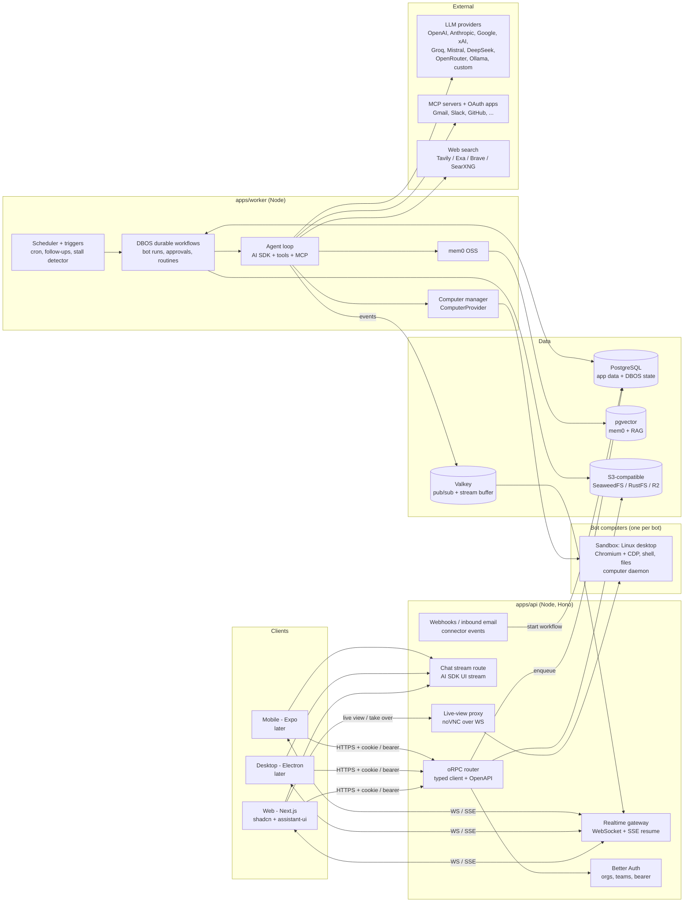

# BotDesk — High-Level Architecture (proposal)

> Status: **proposal for discussion**, 2026-11-11. Nothing is built yet. Library versions and licenses were checked on npm/GitHub on 2026-11-11.
> Product: an open-source (MIT) **Grok Bot**, a team of always-on AI agents ("bots") with their own cloud computers, approvals, group chats, routines and memory. See [vision](../product/vision.md) and [ADR 0001](../decisions/0001-product-scope-and-deployment.md).

## 0. Decided (owner, ADR 0001) — not up for debate here

| # | Decision | What it forces in the architecture |
|---|---|---|
| D0 | Product = open-source Grok Bot (not the grok.com chat app) | Durable background agent runtime + sandboxed computers are the core, chat is the interface |
| D1 | Self-hosted **and** hosted SaaS | Multi-tenant from day one; every tenant table carries `org_id`; self-host = same code via docker-compose |
| D2 | Teams are core: orgs, members, roles, shared threads/projects, bots that belong to a team | Better Auth organization plugin; bots are org-scoped resources with RBAC |
| D3 | @mention people and bots in a chat | Threads have many participants (users + bots); mentions fan out to notifications or bot runs |
| D4 | Model keys: user BYOK **and** org keys; usage per user and per org | Credential resolution order + usage ledger keyed by org/user/bot |
| D5 | Grok's feel, BotDesk's own logo/accent | UI concern only |
| D6 | Web first (Next.js), then Electron, then Expo, all on one API | Separate API service with a typed client + OpenAPI; token auth for native clients |
| D7 | Node.js + PostgreSQL + Drizzle Kit migrations, MIT | Postgres-centric stack; prefer Postgres-native infra (queues, workflows, vectors) |

## 1. Grok Bot in one table (what we are cloning)

| Grok Bot capability | Facts found | BotDesk building block |
|---|---|---|
| Bots = teammates you message | Up to 50 bots + group chats per account; 2–6 bots per group chat | `bots`, `threads`, `thread_participants` |
| Own cloud computer | One persistent Linux VM **shared by all of a user's bots** (files, browser sessions, CLI creds); bots are "separate work surfaces, not separate security boundaries" | `ComputerProvider` (Docker/E2B), **per-bot isolation by default** (differentiator) |
| Works in tools without API/MCP | Browser + desktop computer use | Computer-use loop + Stagehand/Playwright inside the sandbox |
| Signs into your tools | Bot never sees your password: user "takes over" the live computer view to log in / 2FA / CAPTCHA, session persists | Live view (noVNC) with take-over; persisted browser profile per bot; OAuth connectors for API tools |
| Runs while you're away | Jobs survive app close; one computer-use task per bot screen at a time | Durable workflows (DBOS) + per-bot queue partition with concurrency 1 |
| Approvals | Bot returns only for approval/judgment; model-based "Auto Review"; approvals don't undo completed work; no dry-run | Policy engine + approvals inbox + durable wait; we add dry-run and audit |
| Bot-to-bot + group chats | Async bot-to-bot messages that wake the receiver; "chief of staff" pattern (no special manager type) | Mentions → enqueue run for target bot; hop/budget guards |
| Routines ("follow along") | Records browser-only, max 10 min, no audio; output is a draft you refine; 50 routines/bot, 20 run records kept; can be scheduled | `routines` + `routine_versions` (versioned, diffable, exportable — Grok lacks this) |
| Memory + proactive | Remembers conversations, preferences; follows up on dropped threads, nudges stalled handoffs | mem0 OSS + triggers/scheduler + "stall detector" job |
| Clients | macOS + iOS, same thread across devices | Web → Electron → Expo, realtime event stream with resume |
| Usage | Own usage pool, metered weekly, token-billed overage | `usage_events` ledger + budgets |
| Marketplace / Guides | Exists; contents not public (x.ai marketplace page returned 403) | `bot_templates` (versioned JSON packages) |

## 2. System diagram

## 3. Repo layout

**Recommendation: pnpm + Turborepo monorepo** (matches the scaffold already created). *Why:* lightest setup that gives cached builds and shared TS packages across web/desktop/mobile. *Alternative:* Nx (stronger generators/graph, heavier, more opinionated).

| Path | What | Notes |
|---|---|---|
| `apps/web` | Next.js App Router + Tailwind v4 + shadcn/ui + assistant-ui | **Exists.** UI only — no business logic in route handlers except BFF auth glue |
| `apps/api` | Hono HTTP server: oRPC router, chat stream route, realtime gateway, webhooks, live-view proxy, Better Auth | Stateless, horizontally scalable |
| `apps/worker` | DBOS workflows: bot runs, approvals, routines, triggers, memory writes, file ingestion, computer lifecycle | Same codebase as API, separate process; scale independently |
| `apps/desktop` | Electron shell (later) | Loads web UI; adds tray, notifications, deep-link auth, optional "local computer" |
| `apps/mobile` | Expo + NativeWind + react-native-reusables + `@assistant-ui/react-native` (later) | Uses `packages/sdk` |
| `packages/db` | Drizzle schema, migrations, tenant-scoped repositories | Single source of truth for tables |
| `packages/contract` | oRPC contract (zod schemas for every procedure + event types) | Imported by api, sdk, clients |
| `packages/sdk` | Typed client built from the contract + realtime client (WS/SSE with resume) | What web/desktop/mobile call |
| `packages/core` | Domain logic: permissions, key resolution, mention parsing, policy engine, usage pricing | Pure TS, heavily unit-tested |
| `packages/agent` | Agent loop, tool registry, MCP client, model registry, memory adapter (mem0) | Runs in worker |
| `packages/computer` | `ComputerProvider` interface + adapters (`docker`, `e2b`, later `local`) + computer-use/Stagehand tools | |
| `packages/ui` | Shared shadcn components/tokens for web + desktop | Mobile uses RN equivalents |
| `packages/config` | tsconfig, eslint, tailwind preset | |
| `infra/computer-image` | Dockerfile for the bot desktop (Xvfb + XFCE + Chromium + VNC + computer daemon) | Not a JS package |
| `infra/compose` | docker-compose for self-host | |

## 4. Backend shape & client API

| Question | Recommendation | Why (1 line) | Alternative |
|---|---|---|---|
| Where the backend lives | **Separate Node service `apps/api` + `apps/worker`**, not Next.js route handlers | Desktop/mobile/webhooks/bot runtime need a long-running, framework-independent server; Next stays a UI | Next.js route handlers (fine for chat-only, wrong for 24/7 agents) |
| HTTP framework | **Hono** (4.13, MIT) on `@hono/node-server` | Tiny, Web-standard Request/Response (same as AI SDK), runs on Node/Bun/edge | Fastify 5 (mature plugins, Node-only); NestJS (too much ceremony) |
| Typed client | **oRPC** (1.16, MIT) contract-first | One contract → typed client for web/Electron/Expo **and** an OpenAPI spec for third parties/bots calling BotDesk; built-in SSE event iterators | tRPC 11 (no first-class OpenAPI); Hono RPC (types only, no contract package, no OpenAPI) |
| Chat streaming endpoint | Plain Hono route speaking the **AI SDK UI message stream** | `useChat`/assistant-ui transports expect it; works on Expo via `expo/fetch` | Wrap in oRPC event iterator (extra adapter) |
| Auth | **Better Auth** 1.7 (MIT): organization plugin (teams + dynamic access control), `bearer()` for native, `@better-auth/expo`, `@better-auth/electron` | All three client types covered by first-party plugins (all at 1.7.20) | Auth.js; self-hosted Keycloak/Zitadel (heavier) |
| ORM / migrations | **Drizzle ORM + Drizzle Kit** — pin stable `0.45.x`/`0.31.x` now, plan upgrade to 1.0 (RC; new per-folder migrations + `drizzle-kit check`) | SQL-first, light, versioned migrations | Prisma (great DX, heavier runtime, separate schema language) |

**How Electron and Expo call it:** same `packages/sdk` against `https://api.<host>`; web uses cookies (same-site or via Next rewrite), Electron uses deep-link login (`@better-auth/electron`) + bearer token in OS keychain, Expo uses `@better-auth/expo` + SecureStore. Realtime via the same WS endpoint.

## 5. Agent runtime & orchestration (the core)

### 5.1 Durable workflows

| Option | License | Infra needed | Verdict |
|---|---|---|---|
| **DBOS Transact (TS)** | MIT | **Only Postgres** (library, no extra server) | **Recommended.** Durable steps, `send`/`recv` (approvals, bot-to-bot wake-ups), durable sleep, cron, queues with per-partition concurrency, rate limits, dedup, priority |
| Vercel Workflow SDK + `@workflow/world-postgres` | Apache-2.0 | Postgres + graphile-worker | Watch: native fit with AI SDK 7 `WorkflowAgent`, but Postgres World is a "reference implementation, not optimized for scale, speed, or security" |
| Temporal | MIT | Separate Temporal cluster (+ its DB) | Gold standard; too heavy for self-host compose |
| Trigger.dev | Apache-2.0 | Own platform stack (several services) | Great DX, heavy to self-host alongside ours |
| Inngest | SSPL (→ Apache later) | Inngest server | **Avoid** (SSPL not OSI/MIT-compatible for redistribution) |
| pg-boss / BullMQ | MIT | Postgres / Redis | Job queues only, not durable multi-step workflows; DBOS queues cover this |

**Run model**
- Every bot task = one **`bot_run` workflow** on queue `bot-runs`, partition key = `bot_id`, `partitionConcurrency: 1` (one job at a time per bot computer, like Grok), global concurrency per org plan.
- Each LLM turn and each tool call is a DBOS **step** (checkpointed → survives deploys/crashes, no duplicate emails on retry: side-effecting tools carry idempotency keys).
- Agent loop = AI SDK 7 (`ai` 7.0, Apache-2.0) `streamText`/agent with tools, executed inside steps; stream chunks published to Valkey for live UI.
- **Stop/cancel** = `DBOS.cancelWorkflow` + `AbortSignal` into the current step; partial message saved.

### 5.2 Bot-to-bot, group chats, @mentions

- A thread has participants (users and bots). A message mentioning `@bot` → `enqueue bot_run(bot, thread, trigger_message)`. Mentioning `@user` → notification.
- Bots mention other bots the same way (tool `send_message(thread, text, mentions)` / `delegate(bot, task)`), which wakes the receiver — the "chief of staff" pattern needs no special type.
- **Loop guards:** max hop depth per causal chain, per-thread bot-message rate limit, per-run token/cost budget, and "ask a human" fallback.
- **Ownership:** `tasks` table lets bots assign/claim work items visible in the thread (feeds "nudge stalled handoffs").

### 5.3 Approvals (human-in-the-loop)

| Piece | Design |
|---|---|
| Policy | Every tool declares a risk class: `read`, `write-internal`, `external-send` (email/post), `spend`, `destructive`, `credential`. Org → bot → routine policies map class → `auto` / `ask` / `deny` |
| Wait | Workflow calls `DBOS.recv("approval:<id>", timeout)`; zero compute while waiting |
| Inbox | `approvals` table + realtime + push/email; approve/deny/edit-and-approve from any client |
| Integrity | Signed approval tokens (AI SDK 7 supports HMAC-signed approvals); full audit log |
| Auto Review | Optional reviewer model scores proposals; can only *downgrade* to "ask", never bypass a `deny` |
| Dry run | Write-class tools support a `simulate` mode for routine test runs (Grok has none) |

### 5.4 Proactive scheduler & triggers

- `triggers`: `cron`, `webhook`, `inbound_email`, `connector_event` (e.g. Gmail push, GitHub webhook), `follow_up` (bot-created timer: "check back Friday"), `thread_stall`.
- DBOS scheduled workflows run cron; follow-ups = durable sleep; a **stall detector** (hourly) finds open `tasks` / unanswered threads and wakes the owning bot with a "nudge" prompt.

## 6. Bot computers (sandboxes)

**Recommendation: a `ComputerProvider` interface with two adapters from day one.**

| Adapter | Use | License / status | Notes |
|---|---|---|---|
| **`docker`** (default self-host) | One container per bot from `infra/computer-image` | Our image (MIT) bundling Chromium, XFCE, VNC | Run with **gVisor (`runsc`)** for isolation; named volume per bot (home dir + browser profile); controlled by a separate `computer-manager` behind a docker-socket proxy, never the API |
| **`e2b`** (default SaaS) | Firecracker microVM per bot | E2B SDK Apache-2.0; infra self-hostable (`e2b-dev/runtime`, Apache-2.0) | Pause/resume keeps FS + memory; paused sandboxes kept indefinitely; 24h continuous run on Pro (pause resets) |
| `local` (later, Electron) | Bot drives the user's own machine/VM | Cua drivers (MIT) | Opt-in "bring your own computer" |
| ~~Daytona~~ | — | OSS repo **unmaintained since June 2026** (moved private) | Avoid |
| Kasm Workspaces | — | KasmVNC is GPL-2.0 (fine as a separate binary in the image) | Optional VNC server choice; noVNC (MPL-2.0) as web client |

**Inside the computer:** a small **computer daemon** (HTTP over a private network) exposing `screenshot`, `click/type/key/scroll`, `shell`, `files`, and a Chromium **CDP** endpoint.

**How bots act:**

| Layer | Tool | Why |
|---|---|---|
| APIs first | MCP tools + OAuth connectors | Cheapest, most reliable |
| Web pages | **Stagehand** (MIT, TS) on Playwright (Apache-2.0) via CDP | DOM-aware actions with any LLM; cacheable for routines |
| Anything else | Provider **computer-use** tools (Anthropic, OpenAI, etc.) over screenshots | Works on apps with no API/MCP; most expensive |
| Python-only libs | Browser Use (MIT) inside the sandbox | Optional |

**Login / credentials:** like Grok, bots never get raw passwords by default. Bot hits a login → raises a `takeover` approval → user opens **live view** (noVNC proxied through `apps/api`, auth-checked, time-boxed) and logs in → browser profile persists on the bot's volume. Optional per-bot password vault entries (encrypted, `credential` risk class = always ask) for teams that want unattended re-login.

**Isolation choice (differentiator):** default **one computer per bot** (separate profiles = separate blast radius) with an opt-in "shared computer" per user/team. Grok shares one VM across all a user's bots.

## 7. Streaming & realtime

| Concern | Recommendation | Alternative |
|---|---|---|
| Transport | **WebSocket** gateway in `apps/api` for multi-user threads (messages, typing, presence, approvals, bot status) + **SSE** for single-response streams and resume | Centrifugo (Apache-2.0) as a dedicated realtime server if we outgrow it; Postgres LISTEN/NOTIFY for tiny self-hosts |
| Fan-out | **Valkey** (BSD-3) pub/sub + Streams | Redis 8 (AGPL/RSAL/SSPL tri-license — prefer Valkey) |
| Resume mid-generation | Worker appends every chunk to a per-run Valkey Stream (`XADD`, TTL); clients reconnect with last event id and replay; final parts persisted to Postgres | AI SDK pattern: `resumable-stream` (ISC, needs Redis) + `activeStreamId` — usable for the plain 1:1 chat route |
| Multi-device / multi-user | Because generation runs in the worker (not the HTTP request), any number of devices/participants subscribe to the same run | — |
| Stop | Explicit `POST /runs/:id/cancel` (client disconnect ≠ stop, matching AI SDK guidance) | — |
| Presence/typing | Ephemeral, Valkey only, never in Postgres | — |

## 8. Data model sketch

All tenant tables carry `org_id` (indexed, first column of composite indexes). `*` = Better Auth-managed.

| Table | Key columns |
|---|---|
| `user`*, `session`*, `account`*, `verification`* | id, email, name, image; session has `active_organization_id`, `active_team_id` |
| `organization`*, `member`*, `invitation`*, `team`*, `team_member`*, `organization_role`* | org slug/plan; member role(s); dynamic roles |
| `provider_credentials` | id, org_id, owner_user_id (null = org key), provider, base_url, label, `enc_key` (ciphertext), `dek_id`, scopes, created_by |
| `models` | id, org_id (null = global catalog), provider, model_id, display_name, capabilities (vision/tools/reasoning/computer_use), price_in/out per Mtok, context_window |
| `bots` | id, org_id, team_id, name, handle (`@inbox`), avatar, instructions, model_id, fallback_model_id, credential_policy, tool_policy jsonb, memory_scope, computer_mode (own/shared/none), budget, template_id, status |
| `bot_tools` | bot_id, tool_kind (builtin/mcp/connector), ref_id, config, risk_overrides |
| `computers` | id, org_id, bot_id (or user_id if shared), provider (docker/e2b/local), external_id, state (running/paused/stopped), volume_ref, last_active_at |
| `projects` | id, org_id, team_id, name, instructions, default_bots |
| `threads` | id, org_id, project_id, kind (dm/group/bot_internal), title, visibility, created_by, last_message_at |
| `thread_participants` | thread_id, participant_type (user/bot), participant_id, role (owner/member/observer), last_read_seq, muted |
| `messages` | id, thread_id, org_id, seq, author_type (user/bot/system), author_id, parent_id (branching), run_id, parts jsonb (text/reasoning/tool-call/tool-result/file/approval-request), status, edited_at |
| `mentions` | message_id, target_type (user/bot), target_id |
| `notifications` | id, org_id, user_id, kind (mention/approval/run_done/nudge), ref, read_at |
| `runs` | id (= DBOS workflow id), org_id, bot_id, thread_id, trigger_id, parent_run_id (delegation chain), hop, status, started/ended_at, cost_usd |
| `run_steps` | run_id, idx, kind (llm/tool/computer/approval), summary, input/output refs, screenshot_file_id |
| `tasks` | id, org_id, thread_id, title, owner_type/id, assigned_by, status, due_at, last_nudged_at |
| `approvals` | id, org_id, run_id, bot_id, requested_from (user/role), risk_class, action jsonb, status, decided_by, decided_at, signature |
| `routines` / `routine_versions` | routine: id, bot_id, name, schedule; version: n, source (recording/edit), steps jsonb (NL + selectors + decision rules + approval points), recording_file_id |
| `routine_runs` | routine_version_id, run_id, mode (live/dry_run), outcome |
| `triggers` | id, org_id, bot_id, kind, config, next_fire_at, enabled |
| `connections` | id, org_id, owner (user/org/bot), connector (gmail/slack/…/mcp_url), auth_type (oauth/api_key/none), enc_tokens, scopes, expires_at |
| `mcp_servers` | id, org_id, url / command, transport, auth_connection_id, tool_allowlist |
| `files` / `attachments` | file: id, org_id, s3_key, mime, size, sha256, ingest_status; attachment: message_id, file_id |
| `chunks` | file_id, org_id, embedding vector, text, meta (RAG over uploaded docs) |
| `memories` (mem0-owned) + `memory_audit` | mem0 collection in pgvector keyed by `user_id`/`agent_id`; our audit: memory_id, org_id, action, actor, source_message_id |
| `bot_templates` | id, publisher_org_id, slug, version, manifest jsonb (instructions, tools, routines, required connectors), visibility, installs |
| `shares` | id, org_id, resource (thread/bot/template), token, expires_at |
| `usage_events` | id, org_id, user_id, bot_id, run_id, kind (tokens/computer_seconds/tool_call/search), model_id, credential_source (user/org/platform), qty_in/out, cost_usd, ts |
| `usage_rollups`, `budgets` | per org/user/bot per day/week; limits + alert thresholds |
| `audit_log` | org_id, actor, action, target, ip, ts (append-only) |

**Model key precedence (D4):** bot override → org "enforced" key (if admin locks it) → user BYOK (if org allows) → org default key → platform credits (SaaS only). Every `usage_events` row records which source paid.

## 9. Tools, integrations, memory, files

| Area | Recommendation | Why | Alternative |
|---|---|---|---|
| Providers | AI SDK 7 provider packages + `@ai-sdk/openai-compatible` for custom endpoints | One interface, streaming, tools, reasoning parts | LiteLLM proxy (Python service) |
| MCP client | `@ai-sdk/mcp` (Apache-2.0) / `@modelcontextprotocol/sdk` (MIT); remote MCP over Streamable HTTP with OAuth | Standard tool ecosystem, per-org server allowlist | — |
| OAuth connectors | **Own thin connector layer** (Arctic-style OAuth clients, tokens in `connections`) for the first 5–10 apps + MCP for the long tail | Keeps self-host fully MIT, no vendor | **Composio** (SDK MIT, but auth/tools run on Composio cloud) as an optional SaaS plug-in; **Nango** is Elastic License 2.0 — avoid bundling |
| Web search / DeepSearch | Pluggable `search` tool: Tavily / Exa / Brave API, SearXNG for self-host; DeepSearch = a workflow (plan → search → read via sandbox browser → synthesize with citations) | Durable, resumable research | Provider-native search tools |
| Memory | **mem0 OSS** `mem0ai` 3.3 (`mem0ai/oss`, **Apache-2.0**, MIT-compatible) on pgvector via `connectionString`; scopes: `userId`, `agentId` (bot), org via namespaced ids | Prebuilt extraction + retrieval | Own pgvector memory table |
| File storage | **S3 API**; self-host **SeaweedFS** or **RustFS** (both Apache-2.0); SaaS: R2/S3 | **MinIO CE is in maintenance mode / archived** — don't build on it | Garage (AGPL-3.0, separate service so OK, but smaller) |
| File parsing (RAG) | Worker ingestion workflow: PDF/Office/HTML → text → chunks → pgvector; heavy docs via optional Docling sidecar | Bots can also just open files in their computer | Unstructured / LlamaParse (hosted) |

**mem0 caveats (verified):** v3 OSS **removed graph memory** (Neo4j/Memgraph/Kuzu/AGE/Neptune drivers, `enableGraph`, `relations`) — graph is Platform-only now; extraction is a single **ADD-only** pass (no UPDATE/DELETE events → we must build our own dedupe/edit UI); `search` uses `topK` + `filters`; v3 scores shifted (retune thresholds); pgvector TS config supports `connectionString`, `hnsw`, `diskann` (needs pgvectorscale). mem0 does **not** enforce tenancy → wrap it so every call is forced through `filters` with org-scoped ids.

## 10. Self-hosting & deploy

| Path | Components |
|---|---|
| **Self-host (docker-compose)** | `postgres` (pgvector image) · `valkey` · `seaweedfs` (or rustfs) · `api` · `worker` · `web` · `computer-manager` (+ docker-socket-proxy, gVisor runtime recommended) · optional `searxng`. One `.env` (`BOTDESK_MASTER_KEY`, provider keys optional). `pnpm db:migrate` runs as an init container |
| **SaaS / cloud** | web: Vercel or container; api + worker: containers (Fly.io / Railway / ECS / k8s), scaled separately; Postgres: Neon / RDS / Supabase (pgvector); Valkey: managed (e.g. Upstash, ElastiCache); storage: R2/S3; computers: **E2B**; email: Resend/SES; billing (later): Stripe meters fed from `usage_rollups` |
| Migrations | Drizzle Kit generated SQL, applied in CI before deploy; DBOS system tables in a separate schema |

## 11. Security & multi-tenancy

| Concern | Design |
|---|---|
| Secrets at rest | Envelope encryption: AES-256-GCM per-org **DEK**, wrapped by a **KEK** from `BOTDESK_MASTER_KEY` (self-host) or KMS (SaaS). Keys decrypted only in worker memory at call time; never returned to clients (show last 4) |
| Tenancy | `org_id` on every row; all queries through tenant-scoped repositories in `packages/db`; **Postgres RLS** as defense-in-depth (`SET app.org_id`) |
| RBAC | Better Auth org roles (owner/admin/member) + dynamic roles; bot-level permissions (who can talk to / edit / approve for a bot) |
| Rate limiting | Per user/org/IP at API (Valkey token bucket); per-bot and per-org run concurrency via DBOS queues; budgets hard-stop runs |
| Sandbox isolation | Per-bot computer, gVisor/Firecracker, egress allowlist option, no access to internal network, short-lived signed live-view URLs |
| Prompt injection | Untrusted web/email content tagged; risk-class policy means injected instructions still need approval to send/spend/delete; tool output never elevates permissions |
| Audit | Every tool call, approval, credential use and take-over session in `audit_log` + `run_steps` (with screenshots) |
| Bot identity | Connector tokens can be owned by a bot (least privilege) rather than always the human — fixes Grok's "one blast radius" critique |

## 12. Amazing & cool ideas

| # | Idea | What | Why it's cool | Effort | Affects arch now? |
|---|---|---|---|---|---|
| 1 | **Per-bot computers & identities** | Each bot gets its own sandbox and its own connector accounts | Real security boundaries; Grok explicitly lacks them | M | **Yes** — `computers.bot_id`, `connections.owner` |
| 2 | **Run replay / time-travel** | Scrub through a run: every step, screenshot, tool I/O; fork from any step | Trust + debugging for autonomous work | M | **Yes** — `run_steps` with screenshots from day one |
| 3 | **Dry-run & versioned routines** | Routines as diffable versions with a simulate mode and rollback | Grok has no dry-run, no versioning | M | **Yes** — `routine_versions`, tool `simulate` flag |
| 4 | **Visible, editable memory** | "What this bot knows about you/team" page with edit, forget, provenance | Fixes mem0 ADD-only + builds trust | S | Small — `memory_audit` |
| 5 | **Cost meter per message/run + budgets** | Live $ ticker on runs, per-bot weekly budgets, cheaper-model suggestions | BYOK users care about spend | S | **Yes** — `usage_events` per step |
| 6 | **Bring your own computer** | Electron app lets a bot drive your own machine or a local VM | Free compute for self-hosters, access to local apps | L | **Yes** — `ComputerProvider` interface |
| 7 | **Approval rules learned from you** | After N identical approvals, suggest "auto-approve this pattern" | Bots get more autonomous safely over time | M | Small — policy rules table |
| 8 | **Bot template marketplace (git-backed)** | Templates are JSON manifests in a public repo; install = PR-reviewed package | Open-source-native marketplace, no store infra | M | Yes — `bot_templates` manifest format |
| 9 | **Model compare / mixture** | Run the same task on 2 models side-by-side, or have a cheap model draft and a strong one review | Multi-provider is our edge over Grok | S | No |
| 10 | **Command palette + slash-actions** | ⌘K to hand any bot a task, jump to approvals, run routine | Speed, Grok feel | S | No |
| 11 | **Shared team brain** | Org-level memory + project knowledge that all bots read, with per-bot private memory | Team-first, not per-user | M | **Yes** — memory scope design |
| 12 | **Email/Slack-native bots** | Each bot has its own inbox address and can be @mentioned in Slack | Bots live where work happens | M | Yes — inbound triggers |

## 13. Questions for the owner

| # | Question | Recommended default |
|---|---|---|
| 1 | **v1 scope:** what ships first? | Chat with bots (multi-provider, BYOK/org keys) + group threads with @mentions + approvals + MCP/connector tools + memory. **Computers in v1.1** |
| 2 | **Computer hosting for SaaS:** E2B (pay per use) or our own Firecracker/gVisor fleet? | E2B for SaaS launch, Docker+gVisor for self-host; revisit at scale |
| 3 | **Computer per bot or shared per user (like Grok)?** | Per bot by default, shared as an opt-in |
| 4 | **First 5 integrations?** | Gmail, Google Calendar, Slack, GitHub, Linear/Notion (OAuth) + any remote MCP URL |
| 5 | **Approval defaults:** how autonomous out of the box? | `read` auto; `write-internal` auto; `external-send`, `spend`, `destructive`, `credential` ask |
| 6 | Can bots store real passwords for unattended re-login? | No by default (take-over only); org admin can enable vault per bot |
| 7 | **SaaS pricing model:** credits for platform keys, seats, computer-minutes? | Free tier BYOK-only; paid = seats + included computer hours + metered platform tokens |
| 8 | Is Composio (hosted) acceptable as an optional SaaS shortcut for long-tail integrations? | Yes as an optional plugin, never required for self-host |
| 9 | Data residency / retention: how long to keep run screenshots and recordings? | 30 days screenshots, routine recordings kept until deleted; org-configurable |
| 10 | Marketplace: open to anyone, or curated? | Curated public repo first, user-published later |
| 11 | Do we need SSO/SAML and audit export for enterprise in year 1? | Plan the tables now (audit_log), ship SSO later via Better Auth SSO plugin |
| 12 | Voice and image/video generation (Grok app features): in scope? | Out of scope for v1; add as tools later |

## 14. Verified versions & licenses (npm/GitHub, 2026-11-11)

| Package | Version | License | Note |
|---|---|---|---|
| `ai` (Vercel AI SDK) | 7.0.169 | Apache-2.0 | v7 released June 2026 (WorkflowAgent, tool approvals, MCP Apps) |
| `@ai-sdk/mcp` | 2.0.96 | Apache-2.0 | |
| `resumable-stream` | 2.2.13 | ISC | Needs Redis/Valkey |
| `@assistant-ui/react` / `react-native` | 0.15.35 / 0.1.51 | MIT | RN binding is young (0.1.x) |
| `better-auth` (+ expo, electron) | 1.7.20 | MIT | |
| `drizzle-orm` / `drizzle-kit` | 0.45.4 / 0.31.11 | Apache-2.0 / MIT | 1.0 still RC |
| `mem0ai` | 3.3.1 | Apache-2.0 | Graph memory removed in OSS |
| `@orpc/server` | 1.16.2 | MIT | |
| `hono` | 4.13.18 | MIT | |
| `@trpc/server` | 11.28.0 | MIT | alternative |
| `pg-boss` / `bullmq` | 12.38.2 / 6.7.4 | MIT | alternatives |
| `turbo` | 2.11.10 | MIT | |
| DBOS Transact TS | — | MIT | |
| Temporal / Trigger.dev / Inngest | — | MIT / Apache-2.0 / SSPL | |
| E2B SDK / runtime | — | Apache-2.0 | |
| Daytona | — | unmaintained OSS since 2026-06 | |
| Stagehand / Playwright / Browser Use / Cua | — | MIT / Apache-2.0 / MIT / MIT | |
| Composio / Nango | — | MIT (SDK, cloud backend) / Elastic-2.0 | |
| SeaweedFS / RustFS / Garage / MinIO CE | — | Apache-2.0 / Apache-2.0 / AGPL-3.0 / maintenance-mode | |
| KasmVNC / Centrifugo | — | GPL-2.0 / Apache-2.0 | |

## Sources

- Grok Bot launch — https://x.ai/news/introducing-grok-bot
- Grok Bot explainer (shared computer, routines limits, group chats) — https://www.eesel.ai/blog/grok-bot
- Grok Bot FAQ analysis (blast radius, approvals) — https://rohitai.com/blog/xai-grok-bot-always-on-ai-teammates
- eWEEK coverage — https://www.eweek.com/news/grok-bot-ai-agent/
- mem0 Node quickstart — https://docs.mem0.ai/open-source/node-quickstart
- mem0 OSS v2→v3 migration (graph removed) — https://docs.mem0.ai/migration/oss-v2-to-v3
- mem0 pgvector config — https://docs.mem0.ai/components/vectordbs/dbs/pgvector
- mem0 TS package.json — https://github.com/mem0ai/mem0/blob/main/mem0-ts/package.json
- AI SDK 7 announcement — https://vercel.com/blog/ai-sdk-7 · changelog https://vercel.com/changelog/ai-sdk-7
- AI SDK resumable streams — https://ai-sdk.dev/docs/ai-sdk-ui/chatbot-resume-streams
- AI SDK Expo guide — https://ai-sdk.dev/docs/getting-started/expo
- Workflow SDK Postgres World — https://workflow-sdk.dev/docs/deploying/world/postgres-world
- DBOS queues — https://docs.dbos.dev/typescript/tutorials/queue-tutorial · communication https://docs.dbos.dev/typescript/tutorials/workflow-communication
- Better Auth organization plugin — https://better-auth.com/docs/plugins/organization · Expo https://better-auth.com/docs/integrations/expo
- oRPC event iterator — https://orpc.unnoq.com/docs/event-iterator · OpenAPI https://orpc.dev/docs/openapi/getting-started
- assistant-ui React Native — https://www.assistant-ui.com/docs/react-native
- Drizzle v1 upgrade — https://orm.drizzle.team/docs/upgrade-v1
- E2B persistence — https://docs.e2b.dev/sandbox/persistence
- Daytona repo (unmaintained notice) — https://github.com/daytonaio/daytona
- MinIO maintenance mode — https://www.infoq.com/news/2025/12/minio-s3-api-alternatives
- Inngest license — https://github.com/inngest/inngest/blob/main/LICENSE.md · Nango license https://github.com/NangoHQ/nango/blob/master/LICENSE
- GitHub repos: temporalio/temporal, triggerdotdev/trigger.dev, dbos-inc/dbos-transact-ts, vercel/workflow, e2b-dev/E2B, browserbase/stagehand, browser-use/browser-use, trycua/cua, ComposioHQ/composio, seaweedfs/seaweedfs, rustfs/rustfs, kasmtech/KasmVNC, centrifugal/centrifugo
