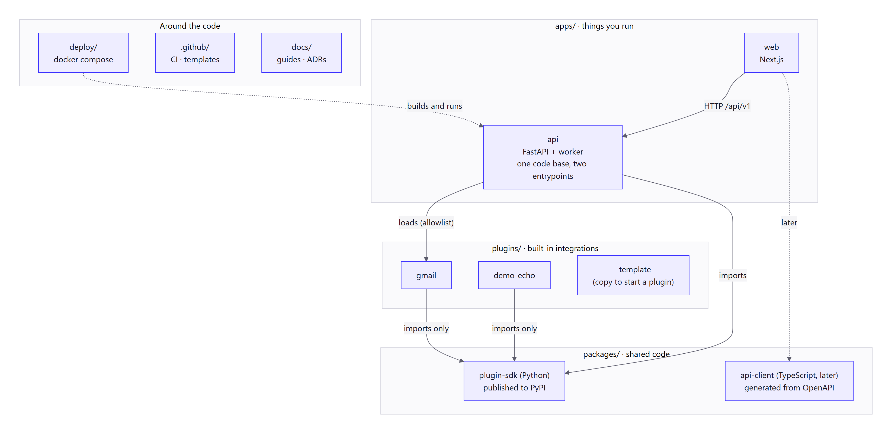

# Repo structure for an open-source BotDesk

**Status:** proposal (2026-11-12), part of the [architecture review](review-2026-11-12.md). Nothing here is built yet; this is the map to build towards, one folder at a time. When you agree it becomes ADR 0006.
**Reading time:** about 15 minutes.

> **The short version:** keep what we have. Add **one** Python package (`packages/plugin-sdk`), a **`plugins/`** folder, a **`deploy/`** folder and a **`.github/`** folder. The worker is **not** a new app: it is a second way to start `apps/api`. Don't create a folder until something real goes in it.

## 1. The picture



**How to read it:** grey boxes are top-level folders. Solid arrows are "depends on". The important thing is the direction of the arrows around the plugin SDK: **the API imports the SDK, plugins import the SDK, and plugins never import the API.** That one rule is what lets a stranger write a plugin without reading our backend.

## 2. The tree

`(exists)` = in the repo today. `(step N)` = add it at that step of the [build order](agents-and-plugins.md#14-build-order-each-step-small-tested-and-usable). `(soon)` = small, add before inviting contributors.

```
botdesk/
├─ apps/                         things you RUN (each one is deployed)
│  ├─ web/                       (exists) Next.js web app
│  ├─ api/                       (exists) FastAPI API **and** the worker: one code base, one image
│  │  ├─ src/
│  │  │  ├─ main.py              (exists) entrypoint 1: the HTTP API
│  │  │  ├─ worker.py            (step 1) entrypoint 2: the job worker  →  `python -m src.worker`
│  │  │  ├─ core/                (exists) config, database, security, errors
│  │  │  ├─ models/              (exists) SQLAlchemy tables
│  │  │  ├─ schemas/             (exists) Pydantic request/response shapes
│  │  │  ├─ services/            (exists) business rules + queries
│  │  │  ├─ controllers/         (exists) one request: call services, commit
│  │  │  ├─ api/v1/routes/       (exists) the HTTP surface
│  │  │  ├─ jobs/                (step 1) the queue app + one small function per job
│  │  │  ├─ agents/              (step 1) run graph, nodes, policy, limits (the "run engine")
│  │  │  ├─ events/              (step 1) event bus: memory / postgres / valkey
│  │  │  └─ plugins/             (step 3) registry + loaders (entry points, later MCP and HTTP)
│  │  ├─ migrations/             (exists) Alembic
│  │  ├─ tests/                  (exists) pytest
│  │  └─ evals/                  (step 2) injection cases + golden conversations
│  ├─ docs/                      (later) docs website, only when Markdown in docs/ isn't enough
│  └─ desktop/, mobile/          (later) Electron and Expo, on the same API
│
├─ packages/                     things you IMPORT (shared code, some published)
│  ├─ plugin-sdk/                (step 3) Python. PyPI: botdesk-plugin-sdk
│  │  ├─ src/botdesk_plugin_sdk/   Tool, TriggerSource, Plugin, Manifest, RiskClass, testing helpers
│  │  ├─ tests/
│  │  └─ pyproject.toml          a real package (unlike apps/api): versioned and published
│  └─ api-client/                (later) TypeScript client generated from /api/openapi.json,
│                                 created when a second client (desktop/mobile) needs it
│
├─ plugins/                      built-in integrations, one folder = one Python package
│  ├─ _template/                 (step 3) copy this to start a plugin
│  ├─ demo-echo/                 (step 2/3) the fake plugin used in tests and docs
│  └─ gmail/                     (step 5)
│     ├─ src/botdesk_gmail/        tools.py, triggers.py, auth.py, plugin.py
│     ├─ manifest.json           generated from the code, committed, checked in CI
│     ├─ tests/
│     ├─ README.md               what it does, scopes it asks for, how to set up Google OAuth
│     └─ pyproject.toml          depends only on botdesk-plugin-sdk (+ its own HTTP libs)
│
├─ deploy/                       how to RUN it yourself
│  └─ docker/
│     ├─ docker-compose.yml      (step 4) postgres, migrate, api, worker, web
│     ├─ docker-compose.dev.yml  (step 0) just Postgres + pgvector, for local development
│     ├─ .env.example            every setting, with comments
│     ├─ api.Dockerfile          one image for api, worker and migrate (different command)
│     └─ web.Dockerfile
│
├─ .github/                      (soon) see §6
├─ docs/                         (exists) product, architecture, adr, backend, frontend, design, research
│  ├─ self-hosting/              (step 4) install, upgrade, back up, settings
│  └─ plugins/                   (step 3) how to write a plugin; the manifest reference
│
├─ README.md  LICENSE  AGENTS.md  GLOSSARY.md      (exist)
├─ CONTRIBUTING.md  SECURITY.md  CODE_OF_CONDUCT.md  CHANGELOG.md   (soon) see §6
├─ package.json  pnpm-workspace.yaml  turbo.json   (exist) JS workspace + task runner for everything
└─ pyproject.toml  uv.lock                         (step 3) Python workspace root, see §4
```

## 3. Why each folder

| Folder | Rule for what goes in | Why it's shaped this way |
|---|---|---|
| `apps/` | Something a person or server **starts**. | The same split Supabase, LibreChat and n8n use: apps are deployed, packages are imported. |
| `apps/api` (API + worker) | All backend code. Two entrypoints. | Dify (`MODE=api` / `MODE=worker`), n8n (`n8n` / `n8n worker`) and Onyx (`api_server` / `background`) all ship **one backend image started two ways**. The worker needs the same models, services and settings as the API; a separate `apps/worker` would have to import them across packages, and our code imports as `from src…`, which two apps can't both use. One code base also means one version: API and worker can never drift. |
| `packages/plugin-sdk` | Only the plugin contract: interfaces, manifest model, risk classes, test helpers. No database, no FastAPI, no LangChain. | It is the one piece outsiders build against, so it must be small, stable and separately versioned. Dify (`dify-plugin`), Activepieces (`pieces-framework`) and Airbyte (CDK) all publish theirs separately. |
| `packages/api-client` | Generated TypeScript types and client. | Only worth a package when two apps share it. Until then generate into `apps/web`. |
| `plugins/` | One folder per built-in integration. Each is its own Python package with its own tests and README. | First-party integrations start **in the repo** in every project we looked at (n8n `nodes-base`, Onyx `connectors/`, Activepieces `pieces/`, Langflow `bundles/`): one pull request can change the SDK and every plugin together. Keeping them as separate packages (not folders inside `apps/api`) forces them through the SDK, which proves the SDK is enough. |
| `deploy/` | Files someone needs to run BotDesk and nothing else. | Self-hosters look for one folder with a compose file and an `.env.example` (Dify `docker/`, Supabase `docker/`, Onyx `deployment/`). Keeping it out of `apps/` makes clear it is for users, not developers. |
| `.github/` | CI, templates, ownership. | Where GitHub looks for them. |
| `docs/` | Markdown. | Works on GitHub with no build. A website can come later and read the same files. |

**Things we are deliberately not adding now**

- `apps/worker`: see above.
- `packages/ui`, `packages/core`, `packages/db` (mentioned in the root README as planned): no second consumer exists. Shared packages created "for later" tend to become junk drawers. Create each one on the day a second app needs it, and update the README table to say so.
- A separate repo for plugins or for the SDK. Dify moved plugins out only after there were hundreds. Start in one repo; split when the number of community plugins makes CI slow.
- An `ee/` folder. Onyx, Activepieces and n8n fence paid code there. BotDesk is all MIT; if that ever changes it needs an ADR first.

## 4. Python packaging: how the pieces find each other

Three kinds of Python project will live here: the app (`apps/api`, not a package), the SDK, and plugins. They need to import each other in development without publishing anything.

**Recommended: a uv workspace at the repo root** (added at step 3, when the second Python project appears). Langflow and Onyx both keep a root `pyproject.toml` + `uv.lock` next to their root `package.json`, so it sits happily beside pnpm.

```toml
# /pyproject.toml  (proposed; not a package itself)
[tool.uv.workspace]
members = ["apps/api", "packages/plugin-sdk", "plugins/*"]
exclude = ["plugins/_template"]
```

```toml
# apps/api/pyproject.toml  (proposed additions)
dependencies = ["botdesk-plugin-sdk", "botdesk-plugin-gmail", "botdesk-plugin-demo-echo", ...]

[tool.uv.sources]
botdesk-plugin-sdk       = { workspace = true }
botdesk-plugin-gmail     = { workspace = true }
botdesk-plugin-demo-echo = { workspace = true }
```

What that gives us: **one lockfile** for all Python code, plugins installed in "editable" mode so a change shows up at once, and `uv run --package botdesk-api …` / `uv build --package botdesk-plugin-sdk` to target one member. The cost: `apps/api/uv.lock` moves to the root and the `pnpm` scripts that call `uv` change slightly. Until step 3 nothing changes.

**The import rules** (checked in CI with [import-linter](https://github.com/seddonym/import-linter), so they don't depend on memory):

```
plugins/*            →  may import  botdesk_plugin_sdk        (and nothing of ours besides)
packages/plugin-sdk  →  may import  nothing of ours
apps/api             →  may import  botdesk_plugin_sdk; loads plugins only through entry points
```

**Names**

| Thing | Folder | PyPI name | Import name | Plugin id |
|---|---|---|---|---|
| SDK | `packages/plugin-sdk` | `botdesk-plugin-sdk` | `botdesk_plugin_sdk` | n/a |
| Gmail | `plugins/gmail` | `botdesk-plugin-gmail` | `botdesk_gmail` | `botdesk.gmail` |
| A community plugin | their repo | `botdesk-plugin-<name>` | their choice | `<their-namespace>.<name>` |

Register the `botdesk-plugin-sdk` name on PyPI early, even with an empty 0.0.1, so nobody else takes it.

## 5. How `apps/api` grows

The layered layout (routes → controllers → services → models) is decided ([ADR 0003](../adr/0003-python-backend.md)) and is working. Three things keep it working as it gets bigger.

**5.1 New kinds of code get their own top-level folder in `src/`, next to the layers.** The run engine is not a "service", and stuffing it into `services/` would bury the most important code in the project.

| Folder | What it is | May call | Must not |
|---|---|---|---|
| `api/`, `controllers/` | HTTP in, HTTP out | services, jobs (to enqueue) | touch models directly; call `agents/` |
| `services/` | Rules + queries for one area | models, other services, `events/` | know about HTTP |
| `jobs/` | One small function per job type: open a session, call a service or the run engine, commit | services, `agents/` | hold business rules |
| `agents/` | The run graph, its nodes, `policy.py`, limits | services (to read and write), `plugins/` registry, `events/` | be imported by routes or controllers |
| `plugins/` | Registry and loaders | the SDK | know about any specific plugin |
| `events/` | The bus interface and its three implementations | core | know what the events mean |
| `core/` | Config, database, security, errors | nothing of ours | grow business rules |

The path of a chat message then reads straight down: `route → controller → service (save message + run) → jobs (enqueue)` … later, in the worker … `jobs.advance_run → agents (graph) → services (save steps) + events (publish)`.

`agents/policy.py` stays a **pure function** with no imports from `services/` or the database. It is the most security-critical file in the project and should be testable with a plain table of inputs and expected outputs.

**5.2 When a layer folder gets crowded, group by area inside it, not by inventing new layers.** Today each layer has about five files, one per area (`auth`, `organization`, `bot`, `thread`, `invitation`). The agent work roughly triples that. The rule:

- Up to about **12 files** in a layer: keep it flat.
- After that, make **the same sub-folders in every layer**, named after the area:

```
services/
  identity/      auth_service.py, organization_service.py, invitation_service.py
  chat/          thread_service.py, message_service.py
  bots/          bot_service.py
  runs/          run_service.py, approval_service.py, usage_service.py
  integrations/  connection_service.py, installation_service.py, trigger_service.py
models/     identity/ chat/ bots/ runs/ integrations/     (same five names)
schemas/    identity/ chat/ bots/ runs/ integrations/
controllers/ …        api/v1/routes/ …
```

Five areas, same names everywhere, so you always know where the matching file is. This keeps the layered style and gets most of the benefit of "one folder per feature" without a rewrite. Do it in one mechanical commit when the time comes, not gradually.

- **An area may only reach into another area through its services**, never its models. `runs` asking `bots` for a bot is `bot_service.get(…)`, not a query on the `bots` table. That is what will let a piece be split out one day, if it is ever needed.

**5.3 Tests mirror the source.** `tests/` gets the same sub-folders, plus:

- `tests/` on **SQLite** stay for fast pure-logic tests (handles, policy, hashing).
- Everything that touches the queue, checkpoints, locks, pgvector or row-level security runs on **real Postgres** (the dev compose file locally; a service container in CI). SQLite cannot run any of those, and "passes on SQLite, breaks on Postgres" is the most likely first production bug.
- `tests/tenancy/`: for every route and job, organization A can't see organization B.
- `evals/`: slower checks that may call a real model; not part of `pnpm check`.

## 6. The files an open-source repo needs

GitHub looks for these by name. Locations are the ones GitHub recognises.

| File | Where | What goes in it | When |
|---|---|---|---|
| `LICENSE` | root | MIT | exists |
| `README.md` | root | What it is, a screenshot, "run it in 5 minutes", links | exists; add the 5-minute path at step 4 |
| `CONTRIBUTING.md` | root | Set-up, `pnpm check`, commit style, "one small step per pull request", how to add a plugin, the DCO line | soon |
| `SECURITY.md` | root | How to report a hole **privately** (GitHub's "Report a vulnerability"), what counts, how fast we answer. This product holds people's mail tokens, so this file matters more than usual. | soon |
| `CODE_OF_CONDUCT.md` | root | Contributor Covenant | soon |
| `CHANGELOG.md` | root | Written by the release tool | with the first release |
| `SUPPORT.md` | `.github/` | Where to ask questions (Discussions), so issues stay for bugs | soon |
| `CODEOWNERS` | `.github/` | Who must review what. Start with one line (`* @owner`), and add `plugins/gmail/ @…` as maintainers join. Extra-careful paths: `apps/api/src/agents/policy.py`, `core/security.py`, `.github/workflows/`. | soon |
| `ISSUE_TEMPLATE/bug.yml`, `feature.yml`, `plugin-request.yml`, `config.yml` | `.github/ISSUE_TEMPLATE/` | Forms, not blank boxes. `config.yml` sends questions to Discussions and security reports to the private form. | soon |
| `pull_request_template.md` | `.github/` | What changed, how it was tested, screenshots for UI, "docs updated?" | soon |
| `dependabot.yml` | `.github/` | Weekly updates for npm, uv/pip, GitHub Actions and Docker, grouped so it's a few PRs, not fifty (the owner's network is slow) | soon |
| `FUNDING.yml` | `.github/` | Sponsor links | optional |
| `GOVERNANCE.md` | root | Who decides, how to become a maintainer | later, when there is a second maintainer |

**DCO, not a CLA.** A CLA (n8n and Open WebUI use one) exists so a company can relicense contributions later. BotDesk is plain MIT with no such plan, so the lighter Developer Certificate of Origin is enough: contributors add `Signed-off-by` with `git commit -s`. Fewer people walk away at the door.

**Licence checks in CI.** AGENTS.md already says "MIT-compatible only". Make a machine check it: a CI job lists every dependency's licence (npm and Python) and fails on anything outside the allow list (MIT, Apache-2.0, BSD, ISC, plus psycopg's LGPL as the one recorded exception). Things to keep out by name: Redis ≥ 7.4 (use Valkey), `langgraph-api` (Elastic licence), Arize Phoenix (Elastic licence).

### CI (GitHub Actions)

Proposed workflows in `.github/workflows/`:

| Workflow | Runs on | Does |
|---|---|---|
| `ci.yml` | every push and pull request | Works out which parts changed, then runs only those jobs: **web** (typecheck, lint, vitest), **api** (ruff, mypy, pytest on SQLite, then pytest on a `pgvector/pgvector:pg17` service container), **plugins + sdk** (their tests, manifest-matches-code check, import rules), **licences**, and **compose smoke** (build the images, `docker compose up`, hit `/api/v1/health`). |
| `e2e.yml` | pull requests that touch `apps/web`, and nightly | Playwright on a production build |
| `release.yml` | pushes to `main` | Opens or updates the release pull request; on merge, tags, builds and publishes (below) |
| `codeql.yml` | weekly + pull requests | Static security scan for Python and TypeScript |

Good habits from the OpenSSF Scorecard, cheap to do from the first workflow: give each workflow the least permissions it needs (`permissions: contents: read` at the top), pin third-party actions to a commit hash, never run untrusted pull-request code with secrets, and protect `main` (CI must pass). Today the owner pushes straight to `main`; that is fine while solo, and branch protection is the first thing to switch on when a second person contributes.

### Versions and releases

Two things get version numbers, on different clocks:

| What | Version | Where it ships |
|---|---|---|
| **BotDesk the app** (web + api + built-in plugins together) | one number, `v0.3.0` | Docker images on GitHub Container Registry, a GitHub Release with notes |
| **The plugin SDK** | its own number, `sdk-v0.2.0`, strict semantic versioning | PyPI |

Recommended tool: **release-please** in "manifest" mode (Apache-2.0). It reads commit messages (the repo already writes `feat(web): …`, `docs: …`), keeps a release pull request up to date with the changelog, and tags when you merge it. It understands both `package.json` and `pyproject.toml` in one config, which changesets (JavaScript-only at heart) does not. Publishing the SDK is then a short job: `uv build --package botdesk-plugin-sdk` and `uv publish`, signed in to PyPI by **Trusted Publishing** (no stored password).

Two promises that make upgrades safe for self-hosters:

1. **The manifest has its own `manifestVersion`**, and the app says which SDK versions it accepts. A plugin built for SDK 1.x keeps loading on every 1.x app.
2. **Every release note has an "Upgrading" section** when a migration or a new setting is involved. Database migrations only ever go forward and are run by the `migrate` step.

### Self-hosting: one compose file

`deploy/docker/docker-compose.yml`, five services, one of which exits after doing its job:

| Service | Image | Notes |
|---|---|---|
| `postgres` | `pgvector/pgvector:pg17` | With a volume. Self-hosters with their own Postgres remove this service and set two URLs. |
| `migrate` | the api image, command `alembic upgrade head` (+ queue and checkpoint tables) | Runs once, then stops. `api` and `worker` wait for it. |
| `api` | the api image | |
| `worker` | the **same** api image, command `python -m src.worker` | |
| `web` | the web image | |
| `valkey` | optional, behind a compose **profile** | Only when the event bus is switched to it |

Compare: Langflow's example is 2 services, LibreChat 6, Onyx 15, Dify 47 (most optional). Staying at five, with Postgres as the only database, is a real advantage for a self-hosted product. Protect it: any new required service needs an ADR.

`.env.example` documents every setting. The ones this review adds: `DATABASE_URL`, `DATABASE_URL_DIRECT`, `WORKER_MODE`, `EVENT_BUS`, `BOTDESK_PLUGINS`, `BOTDESK_ENCRYPTION_KEYS`, `MEM0_TELEMETRY=False`, and the Google OAuth client id and secret.

### Docs website (later)

Markdown in `docs/` is enough until people who aren't developers need a guide. Then: **Fumadocs** (MIT, built on Next.js, so it's the stack we already know) as `apps/docs`, reading the same Markdown. Docusaurus and Starlight are also MIT and fine. Avoid Mintlify (hosted and paid) and MkDocs Material (in maintenance mode, being replaced by Zensical).

## 7. For plugin authors: what "easy" should look like

The structure above exists to make this path short:

1. `cp -r plugins/_template plugins/calendar` (later: a `botdesk-plugin new` command or a Copier template, so community plugins in their own repos get template updates).
2. Write tools as small classes with Pydantic input and output models and a risk class.
3. `uv run pytest plugins/calendar`: the SDK's test helpers run a tool through a fake pipeline, no database, no server.
4. `botdesk-plugin manifest` writes `manifest.json`; CI checks it matches.
5. Add the id to `BOTDESK_PLUGINS`, start the app, connect an account.

A plugin `README.md` and the manifest could later carry a **quality level** in the style of Home Assistant's bronze / silver / gold scale (has tests, handles expired tokens, has a polling fallback, documents its scopes). That gives contributors a checklist and users a signal, with no gatekeeping.

## 8. Order to do it in

Nothing here needs a big-bang change. Fold it into the build order:

| When | Do |
|---|---|
| Now (docs only) | Agree this layout; write ADR 0006. Fix the root README's `packages/*` row. |
| Step 0 | `deploy/docker/docker-compose.dev.yml` (Postgres + pgvector). `.github/workflows/ci.yml` with the web and api jobs. `CONTRIBUTING.md`, `SECURITY.md`, `CODE_OF_CONDUCT.md`, issue and PR templates, `CODEOWNERS`, `dependabot.yml`. |
| Step 1 | `src/jobs/`, `src/agents/`, `src/events/`, `src/worker.py`. |
| Step 3 | Root uv workspace. `packages/plugin-sdk`, `plugins/_template`, `plugins/demo-echo`. Import rules in CI. `docs/plugins/`. |
| Step 4 | `deploy/docker/docker-compose.yml`, the two Dockerfiles, `.env.example`, `docs/self-hosting/`, the compose smoke test, `release.yml` and the first tagged release. |
| Step 5 | `plugins/gmail`. |
| When a layer passes ~12 files | Group by area (§5.2), in one commit. |
| When a second client app starts | `packages/api-client`. |

## Sources

- Repo layouts: [Dify](https://github.com/langgenius/dify) ([entrypoint with MODE](https://raw.githubusercontent.com/langgenius/dify/main/api/docker/entrypoint.sh), [docker/](https://github.com/langgenius/dify/tree/main/docker)), [n8n packages](https://github.com/n8n-io/n8n/tree/master/packages) and [queue mode](https://docs.n8n.io/hosting/scaling/queue-mode/), [Langflow root pyproject (uv workspace)](https://raw.githubusercontent.com/langflow-ai/langflow/main/pyproject.toml), [Onyx](https://github.com/onyx-dot-app/onyx) ([compose](https://raw.githubusercontent.com/onyx-dot-app/onyx/main/deployment/docker_compose/docker-compose.yml), [connectors](https://github.com/onyx-dot-app/onyx/tree/main/backend/onyx/connectors)), [LibreChat](https://github.com/danny-avila/LibreChat), [Activepieces](https://github.com/activepieces/activepieces) ([pieces](https://www.activepieces.com/docs/build-pieces/building-pieces/piece-definition)), [Supabase self-hosting](https://supabase.com/docs/guides/self-hosting/docker), [Open WebUI](https://github.com/open-webui/open-webui), [Sentry self-hosted](https://develop.sentry.dev/self-hosted/)
- Plugin SDKs published separately: [dify-plugin-sdks](https://github.com/langgenius/dify-plugin-sdks), [dify-official-plugins](https://github.com/langgenius/dify-official-plugins), [dify-plugin-daemon](https://github.com/langgenius/dify-plugin-daemon), [Airbyte Python CDK](https://github.com/airbytehq/airbyte-python-cdk), [Home Assistant quality scale](https://raw.githubusercontent.com/home-assistant/developers.home-assistant/master/docs/core/integration-quality-scale/index.md)
- Licences that separate paid code: [Onyx](https://github.com/onyx-dot-app/onyx/blob/main/LICENSE), [Activepieces](https://github.com/activepieces/activepieces/blob/main/LICENSE), [n8n](https://github.com/n8n-io/n8n/blob/master/LICENSE.md), [Dify](https://raw.githubusercontent.com/langgenius/dify/main/LICENSE)
- uv workspaces: [docs.astral.sh/uv/concepts/projects/workspaces](https://docs.astral.sh/uv/concepts/projects/workspaces/); building and publishing: [uv package guide](https://docs.astral.sh/uv/guides/package/); [PyPI Trusted Publishing](https://docs.pypi.org/trusted-publishers/using-a-publisher/)
- GitHub community files: [default community health files](https://docs.github.com/en/communities/setting-up-your-project-for-healthy-contributions/creating-a-default-community-health-file), [issue templates](https://docs.github.com/en/communities/using-templates-to-encourage-useful-issues-and-pull-requests/configuring-issue-templates-for-your-repository), [CODEOWNERS](https://docs.github.com/en/repositories/managing-your-repositorys-settings-and-features/customizing-your-repository/about-code-owners)
- Security habits: [OpenSSF Scorecard checks](https://github.com/ossf/scorecard/blob/main/docs/checks.md), [Best Practices badge criteria](https://www.bestpractices.dev/en/criteria/0); DCO: [OpenStack replacing its CLA with DCO](https://governance.openstack.org/tc/resolutions/20250520-replace-the-cla-with-dco-for-all-contributions.html)
- Releases: [release-please manifest mode](https://github.com/googleapis/release-please/blob/main/docs/manifest-releaser.md), [changesets beyond npm](https://changesets.dev/guide/beyond-npm)
- CI pieces: [dorny/paths-filter](https://github.com/dorny/paths-filter), [astral-sh/setup-uv](https://github.com/astral-sh/setup-uv), [pnpm/action-setup](https://github.com/pnpm/action-setup), [Turborepo on GitHub Actions](https://turborepo.dev/docs/guides/ci-vendors/github-actions), [Postgres service containers](https://docs.github.com/en/actions/tutorials/use-containerized-services/create-postgresql-service-containers), [pgvector images](https://hub.docker.com/r/pgvector/pgvector/tags)
- Docs sites: [Fumadocs](https://github.com/fuma-nama/fumadocs), [Docusaurus](https://github.com/facebook/docusaurus), [Starlight](https://github.com/withastro/starlight), [MkDocs Material → Zensical](https://squidfunk.github.io/mkdocs-material/blog/2025/11/05/zensical/); templates: [Copier](https://github.com/copier-org/copier)
