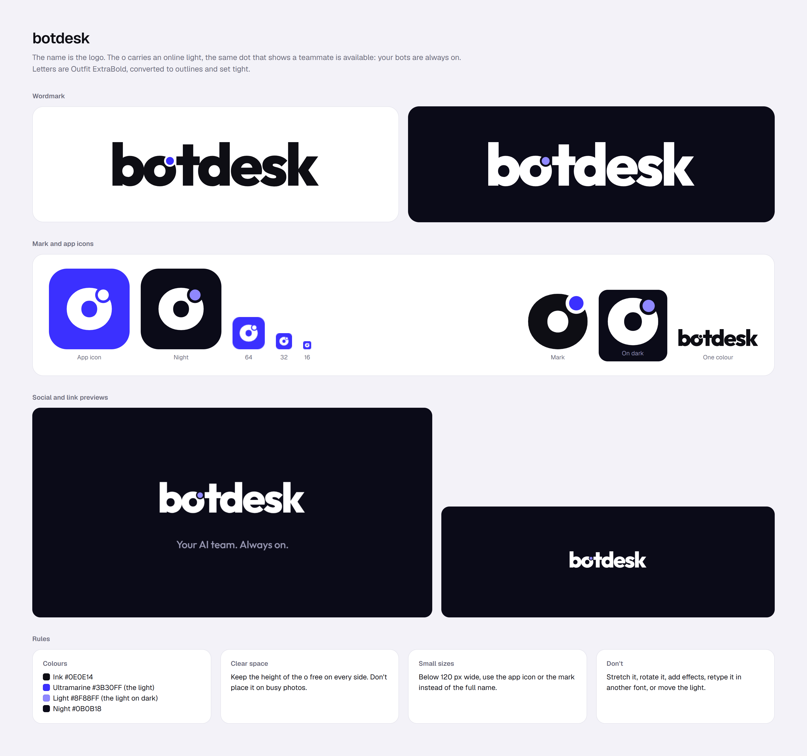

# Logo

**The name is the logo.** `botdesk` in Outfit ExtraBold, set tight, with an **online light** on the o: the same dot that shows a teammate is available. Your bots are always on.



## The parts

- **Wordmark:** `botdesk`, lowercase, Outfit ExtraBold (800), letter spacing −0.05 em, converted to outlines (no font needed).
- **The light:** a dot on the upper-right edge of the o, like a status badge on an avatar. A thin cut around it keeps it clear of the letter. It's the only colour in the logo.
- **Mark:** the o with its light, on its own. Use it where the full name doesn't fit: app icons, favicons, the collapsed sidebar.
- **Colours:**

  | Name | Hex | Used for |
  |---|---|---|
  | Ink | `#0E0E14` | Letters on light backgrounds |
  | Ultramarine | `#3B30FF` | The light; app icon background |
  | Light | `#8F88FF` | The light on dark backgrounds |
  | Night | `#0B0B18` | Dark backgrounds |
  | White | `#FFFFFF` | Letters on dark or ultramarine |

## Which file to use

All files are in this folder: `svg/`, `png/` and `favicon.ico`.

| Need | Use |
|---|---|
| Logo on a website, doc or slide (light background) | `svg/wordmark-ink.svg` |
| Logo on a dark background | `svg/wordmark-white.svg` |
| One colour only (print, stamps, embossing) | `svg/wordmark-ink-mono.svg`, `svg/wordmark-white-mono.svg` |
| The mark alone | `svg/mark-ink.svg`, `svg/mark-white.svg`, `svg/mark-ultramarine.svg`, `png/mark-{ink,white}-{64…1024}.png` (transparent) |
| App icon | `svg/app-icon.svg` (ultramarine), `svg/app-icon-night.svg`, `png/app-icon-{16…1024}.png` (rounded corners) |
| iOS and app stores | `png/apple-touch-icon.png` (180, square), `png/app-store-1024.png` (square; the OS rounds it) |
| Browser tab | `favicon.ico` (16/32/48), `svg/favicon.svg` (switches with the browser's light or dark theme) |
| Link previews | `png/og-image-1200x630.png`, `png/github-social-1280x640.png` |
| Social profiles | `png/avatar-800.png`, `png/banner-1500x500.png` |
| Raster wordmark | `png/wordmark-{ink,white}-200h.png` |

The web app uses the same shapes: `apps/web/src/features/shell/logo.tsx` draws the wordmark and mark from `logo-data.ts`. The favicon and touch icon live in `apps/web/src/app/`.

## Rules

- **Clear space:** keep at least the height of the o free on every side.
- **Small sizes:** below 120 px wide, use the mark or the app icon instead of the full name.
- **Backgrounds:** solid colours only; on photos, put it on a solid panel.
- **Don't:** stretch, rotate, outline, add shadows or glows, retype it in another font, recolour the letters, or move the light.

## Changing or regenerating the files

Everything is generated from the Outfit letters by one script:

```bash
node docs/design/logo/tools/build.mjs     # writes svg/, png/, favicon.ico and the web app's copies
node docs/design/logo/tools/render.mjs    # re-renders overview.png from overview.html
```

The settings (letter spacing, where the light sits, its size) are at the top of [tools/export.html](tools/export.html). The build uses Playwright from `apps/web` with your installed Chrome, and loads opentype.js 1.3.4 and Outfit 5.1.0 (SIL Open Font License) from jsDelivr.

## How we got here

The logo took eleven rounds. The bd monogram (v1–v7) was approved, then outgrown. After that came mixes (v8), new symbols (v9) and style worlds (v10). The owner then picked the **wordmark** direction (v11), and from it "Online": the o with an online light. The old rounds were deleted; git history keeps them. What they taught:

- Plain flat shapes and glossy gradient icons both felt cheap.
- A gap that reads as a cut, and pointed shapes that read as narrowed eyes, felt wrong.
- Calligraphy didn't suit the brand.
- What worked: bold, confident letters with one meaningful detail, and nothing hidden.
